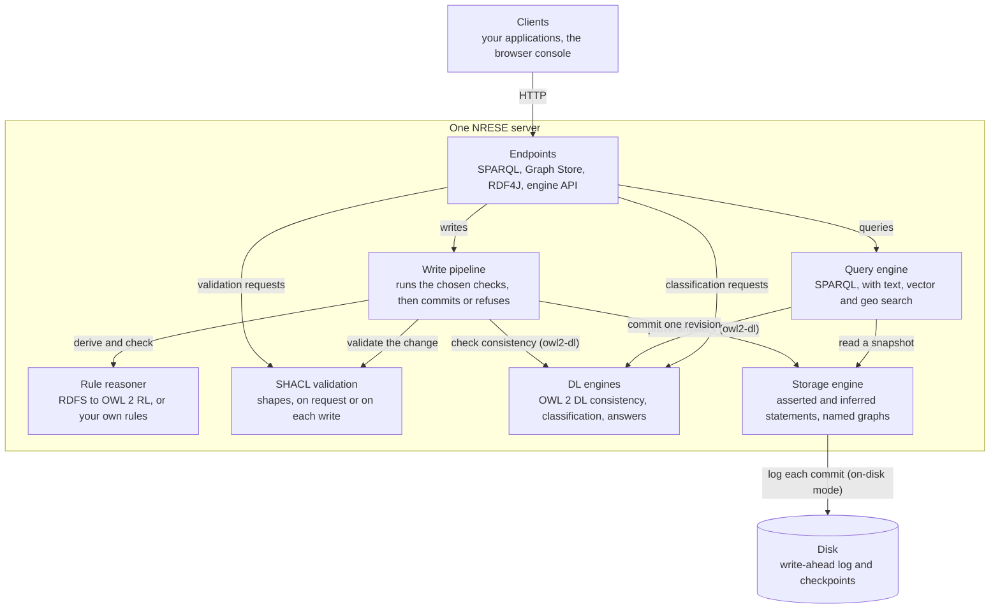

# NRESE

NRESE is an [RDF](https://www.w3.org/TR/rdf11-primer/) database with
[OWL](https://www.w3.org/TR/owl2-primer/) reasoning, written in Rust, that runs as one
server with SPARQL endpoints. It is built for applications that need to know what an answer
rests on: what was asserted, what was inferred from it, and whether anything may be missing.

What it puts first:

- **Inferences are committed with the write.** With reasoning on, a write and the statements
  the rules derive from it become visible together, and a deleted statement takes along the
  inferences that no longer follow.
- **Writes can be checked before they commit.** Under OWL 2 QL, RL and DL, a write that fails
  a consistency check is refused whole, and so is one that introduces a SHACL violation when
  the SHACL gate is set to `enforce`.
- **Every SPARQL answer over HTTP carries a status:** `complete`, `sound-only` (rows may be
  missing), `unsound` (rows may be wrong or missing) or `not-certified` (no assessment).
- **Inferences explain themselves.** Ask why a statement the rules derived holds, and you get
  its derivation from asserted statements, rule by rule.
- **OWL 2 DL engines of its own.** In the `owl2-dl` mode they classify the ontology, prove
  query answers beyond what the rules derive and, by default, check writes for consistency.
  They are a hypertableau and a consequence-based engine.

A write is a SPARQL update, a Graph Store write or a transaction's commit. A bulk load skips
the checks; after one succeeds, the load command and the import endpoint recompute inferences.
Access rights and budgets can limit any answer. A hobby project: [quick start](#quick-start), [Limits](docs/limits.md).

## Architecture overview



Everything in the frame is one process. What happens to a write, step by step:
[what a commit does](docs/what-it-covers.md#what-a-commit-does).

## What NRESE offers

| Feature | What you get |
|---|---|
| [Reasoning](docs/what-it-covers.md#reasoning) | Modes from none to OWL 2 DL: RDFS, RDFS-Plus, OWL-Horst, OWL 2 QL, RL and DL; or your own rules, alone or added to any mode but none |
| [Inferred statements](docs/ops/http-api.md#queries) | Stored apart from asserted ones; a query reads both, asserted only, or inferred only |
| [Consistency checks](docs/what-it-covers.md#what-a-commit-does) | Under OWL 2 QL, RL and DL, on each write; the OWL 2 DL engines' check can be switched off |
| [Answer status](docs/what-it-covers.md#what-an-answer-promises) | One of four on every SPARQL answer over HTTP; under OWL 2 DL, you can ask for an answer proven complete, or else an error |
| [Explanations](docs/ops/http-api.md#engine-api-apiv1) | Why an inferred statement holds, as its derivation; under OWL 2 DL, for one the rules don't derive, the axioms it follows from |
| [Classification](docs/ops/http-api.md#classification) | The ontology's class hierarchy, and the classes of each named individual |
| [SHACL](docs/what-it-covers.md#shacl) | SHACL Core and SHACL-SPARQL, inferred statements included by default; on request, or on each write as a report or a refusal |
| [SPARQL and search](docs/what-it-covers.md#sparql) | SPARQL 1.1 query and update, with the deviations in Limits; full-text, vector and, in part, GeoSPARQL search |
| [Named graphs](docs/ops/config-reference.md#store.default_graph) | Statements in named graphs; a query's default graph is the default graph, or the union of all graphs |
| [Storage](docs/what-it-covers.md#storage-transactions-and-durability) | Its own storage engine, in memory or on disk; backups and restores; read replicas |
| [Access control](docs/what-it-covers.md#access-control-and-operations) | Sign-in by tokens, OIDC, or client certificates passed on by a TLS proxy; read and write rights per named graph |
| [Interfaces](docs/what-it-covers.md#interfaces) | SPARQL 1.1 and Graph Store protocols, the RDF4J REST protocol (not its `SNAPSHOT` or `SERIALIZABLE` isolation), an engine API with an OpenAPI description, a browser console in the Docker image; several repositories per server |

## Quick start

You need:

- git
- Docker with BuildKit (the image builds the server and its console, so no Rust or Node.js)
- curl
- port 8080 free
- a POSIX shell: Linux, macOS, or Git Bash or WSL on Windows

The image's server runs on an x86-64-v3 (amd64) or Neoverse N1 level (arm64) CPU; for an older one, build with `--build-arg NRESE_TARGET_CPU=portable`.

```bash
git clone https://github.com/Krarilotus/OWL-RS.git
cd OWL-RS
docker build -t nrese .
docker run -d --name nrese -p 127.0.0.1:8080:8080 -v nrese-data:/var/lib/nrese/data \
  -e NRESE_REASONING_MODE=owl2-rl -e NRESE_SHACL_GATE=enforce nrese
until curl -sf http://localhost:8080/readyz; do sleep 1; done
```

The server's compile in `docker build` took under 6 minutes with 8 build jobs on an AMD Ryzen 9
5950X; a first build also downloads the base images and builds the console.

The last line waits until the server answers `{"status":"ready"}`. If it never does,
`docker logs nrese` shows the server's output ([startup errors](docs/ops/server-setup.md#startup-errors)).

The server keeps its data on the volume `nrese-data`, listens on this machine only, and has
no authentication on. It reasons under OWL 2 RL, with the SHACL gate set to `enforce` for the
[tutorial](docs/tutorial.md). The browser console is at `http://localhost:8080/console`.

### A first answer: inference

Store that every cat is an animal, and that Tom is a cat. The response is empty:

```bash
curl http://localhost:8080/dataset/update --data-urlencode 'update=
  PREFIX ex: <http://example.org/>
  PREFIX rdfs: <http://www.w3.org/2000/01/rdf-schema#>
  INSERT DATA { ex:Cat rdfs:subClassOf ex:Animal . ex:tom a ex:Cat }'
```

Ask for every animal:

```bash
curl -i http://localhost:8080/dataset/query --data-urlencode 'query=
  PREFIX ex: <http://example.org/>
  SELECT ?x WHERE { ?x a ex:Animal }'
```

```text
HTTP/1.1 200 OK
content-type: application/sparql-results+json
nrese-completeness: sound-only; regime=owl2-rl; reasons="rules: answers over the owl2-rl closure: …"

{"head":{"vars":["x"]},"results":{"bindings":[{"x":{"type":"uri","value":"http://example.org/tom"}}]}}
```

- `ex:tom` is in the answer because the update's commit also stored the inferred statement
  `ex:tom a ex:Animal`.
- `sound-only` says rows may be missing. The reason here: the answers come from the OWL 2 RL
  rules, not from every answer OWL 2 DL entails
  ([what an answer promises](docs/what-it-covers.md#what-an-answer-promises)).

Ask again, for asserted statements only:

```bash
curl -i http://localhost:8080/dataset/query --data-urlencode 'query=
  PREFIX ex: <http://example.org/>
  SELECT ?x WHERE { ?x a ex:Animal }' --data infer=false
```

```text
HTTP/1.1 200 OK
content-type: application/sparql-results+json
nrese-completeness: complete

{"head":{"vars":["x"]},"results":{"bindings":[]}}
```

No animal was asserted, so there are no rows. No reasoning was involved, so the answer is
`complete`. In both outputs other headers are left out, and `…` marks shortened text.

The [tutorial](docs/tutorial.md) goes on from here: retraction, validation,
[your own data](docs/tutorial.md#your-own-data), a changed setting, and starting over.

Without Docker, from source with Rust: [getting started](docs/dev/getting-started.md#run-the-server).

## How it is built

The workspace is split into crates by what they own. Dependencies, dev-dependencies aside,
point down only: a crate may use a crate in a lower layer, or one placed below it in its own
layer, never one above. [ARCHITECTURE.md](docs/ARCHITECTURE.md) follows a write and a query from
request to answer, names for each concept its page and its code, and says at which layer
each kind of problem is fixed; the decisions behind it, with their reasons, are in
[adr/](docs/adr/README.md). Which crates can be used on their own, and what each one uses:
[crates](docs/ARCHITECTURE.md#24-dependencies-and-using-a-crate-on-its-own).

## Documentation

| To | Read |
|---|---|
| Go on from the quick start | [tutorial](docs/tutorial.md) |
| Know what it does, with each part's limits | [what it covers](docs/what-it-covers.md) |
| Know what changed since `main`, and what is slower | [release notes, 1.5 (prerelease)](docs/releases/v1.5.md) |
| Build, run and develop | [getting-started.md](docs/dev/getting-started.md), [CONTRIBUTING.md](CONTRIBUTING.md) |
| Deploy, load data, back up | [server-setup.md](docs/ops/server-setup.md) |
| Look up an endpoint or a setting | [http-api.md](docs/ops/http-api.md), [config-reference.md](docs/ops/config-reference.md) |
| Fix an error | [startup errors](docs/ops/server-setup.md#startup-errors), [status codes](docs/ops/http-api.md#status-codes) |
| Know what reasoning computes | [reasoning-semantics.md](docs/spec/reasoning-semantics.md) |
| Understand the design | [ARCHITECTURE.md](docs/ARCHITECTURE.md), [design/](docs/design/), the decisions in [adr/](docs/adr/) |
| Find any other document | [docs/README.md](docs/README.md) |

## State and limits

Which commit these pages describe: `git log -1` in your clone, or the commit GitHub shows
beside the file. A running server names its build at `/version`: `version`, the package version, and with reasoning on `reasoning_semantics`,
the ruleset with its semantics version and a fingerprint of what it derives
([reasoning-semantics.md](docs/spec/reasoning-semantics.md)).

Changes that affect stored data, answers or clients, with their dates and what to do:
[dated changes](docs/STATUS.md#dated-changes). What is in, what is left out and when to choose
another system, and what is planned: the [scope](docs/what-it-covers.md#scope). The
contributors' record of what is done and open, item by item: [docs/STATUS.md](docs/STATUS.md).

Platforms: the image for `linux/amd64` and `linux/arm64`; the merge checks also build and
test on Windows ([scripts/check.sh](scripts/check.sh)). Stopping, and what a crash or a kill
keeps: [stopping](docs/ops/server-setup.md#64-stopping),
[durability](docs/spec/02-storage-and-transactions.md#durability-on-disk-mode); backups and
restores: [server setup](docs/ops/server-setup.md#10-backup-and-recovery-setup),
[drills](docs/ops/backup-restore-drills.md).

## Thanks

Many of NRESE's ideas come from the research literature and from systems such as QLever,
Konclude, HermiT and RDFox. Its first prototype was built on Oxigraph. Thanks to their
authors.

## Licence

Copyright (C) 2026 Krarilotus. Licensed under either of the
[Apache License, Version 2.0](LICENSE-APACHE) or the [MIT licence](LICENSE-MIT), at your
option. The v1 prototype published before October 2026 (`main` up to `8088e9a`) carried
`Apache-2.0` in its package metadata; that statement stands for those commits.
Third-party material keeps its own licence: the dependencies (MIT, Apache-2.0, BSD and
similar; the accepted licences are in [deny.toml](deny.toml)), the vendored vocabularies
(sources and terms in [their README](benches/nrese-bench-harness/fixtures/catalog-cache/README.md)),
the rule file under `benches/reasoning/nemo/sparq/` ([its licence](benches/reasoning/nemo/sparq/LICENSE)),
and the W3C test suites, which are fetched and not part of this repository.
Contributions come in under the same terms: [CONTRIBUTING.md](CONTRIBUTING.md).
