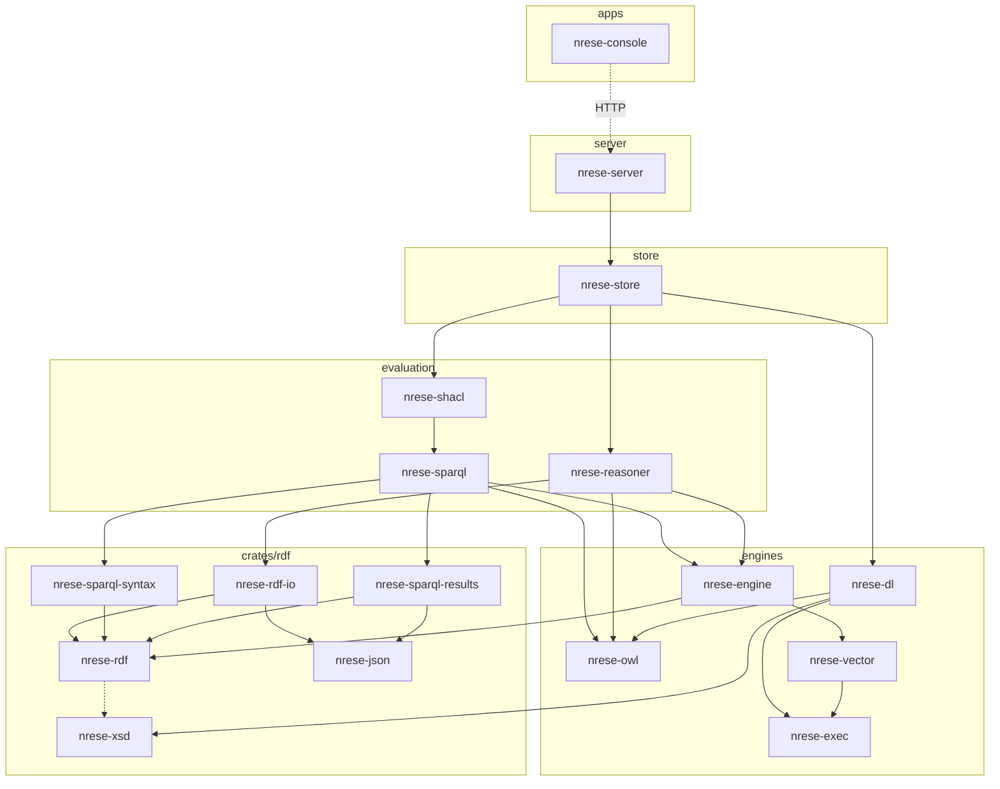

# NRESE

An RDF store with built-in OWL reasoning, written in Rust. A hobby project, developed in
the open.

NRESE stores RDF datasets and answers SPARQL 1.1 queries and updates. It keeps inferred
statements up to date on every commit, so you query them like asserted ones. Reasoning
goes from RDFS to OWL 2 DL; in the OWL 2 QL, RL and DL modes a commit that would make
the data inconsistent is rejected, with the reason. Every SPARQL answer carries a status
that says what it promises (complete, or sound with rows possibly missing, and why) and
warns where it can promise neither. SHACL validation, full-text and vector search,
graph-level access control and the SPARQL, Graph Store and RDF4J protocols are built in.
It runs as one server binary with a browser console, or as a set of Rust crates.

It may suit you if you:

- query data together with its ontology and want the inferences to follow every change;
- need to know when an answer under OWL reasoning may be missing rows;
- want a store you can read and take apart: small crates in clear layers.

Not there yet: parallel writes (one commit at a time), automatic failover (read replicas
only), named graphs as reasoning boundaries, packages on crates.io. Every limit, and when to
choose another system: [Limits and deviations](docs/limits.md).

## Quick start

With Docker (the image builds the server and the console; data on a volume; the port
bound to this machine only, since no authentication is on; reasoning under OWL 2 RL, and
the SHACL commit gate on, which the example below uses):

```bash
docker build -t nrese .
docker run -p 127.0.0.1:8080:8080 -v nrese-data:/var/lib/nrese/data \
  -e NRESE_REASONING_MODE=owl2-rl -e NRESE_SHACL_GATE=enforce nrese
```

The image is built for CPUs from x86-64-v3 (amd64) or Neoverse N1 (arm64) on; for an
older CPU add `--build-arg NRESE_TARGET_CPU=portable`. The image's console is at
`http://localhost:8080/console`.

No authentication is on by default. Set `NRESE_AUTH_MODE`, or a deployment posture that
requires it, before you expose the server ([access control](#access-control-and-operations)).

### A first example: inference, retraction, validation

Add a class hierarchy and an instance, then ask for the instances of the superclass:

```bash
curl http://localhost:8080/dataset/update --data-urlencode 'update=
  PREFIX ex: <http://example.org/>
  PREFIX rdfs: <http://www.w3.org/2000/01/rdf-schema#>
  INSERT DATA { ex:Cat rdfs:subClassOf ex:Animal . ex:tom a ex:Cat }'

curl -i http://localhost:8080/dataset/query --data-urlencode 'query=
  PREFIX ex: <http://example.org/>
  SELECT ?x WHERE { ?x a ex:Animal }'
```

```text
HTTP/1.1 200 OK
content-type: application/sparql-results+json
nrese-completeness: sound-only; regime=owl2-rl; reasons="rules: answers over the owl2-rl closure: …"

{"head":{"vars":["x"]},"results":{"bindings":[{"x":{"type":"uri","value":"http://example.org/tom"}}]}}
```

The answer has `ex:tom`, because `ex:tom a ex:Animal` was inferred. The
`NRESE-Completeness` header says `sound-only`: every row is entailed, and the rules are
complete only for ontologies inside the OWL 2 RL profile, which isn't checked per query
([what an answer promises](#what-an-answer-promises)).

Delete the premise, and the inference goes with it, in the same commit:

```bash
curl http://localhost:8080/dataset/update --data-urlencode 'update=
  PREFIX ex: <http://example.org/>
  DELETE DATA { ex:tom a ex:Cat }'
```

The same query now answers no rows: `{"head":{"vars":["x"]},"results":{"bindings":[]}}`.

Now a shape, stored in the shapes graph: every animal needs a name. A cat without one is
an animal by inference, so the gate rejects it:

```bash
curl http://localhost:8080/dataset/update --data-urlencode 'update=
  PREFIX ex: <http://example.org/>
  PREFIX sh: <http://www.w3.org/ns/shacl#>
  INSERT DATA { GRAPH <http://rdf4j.org/schema/rdf4j#SHACLShapeGraph> {
    ex:AnimalShape a sh:NodeShape ; sh:targetClass ex:Animal ;
      sh:property [ sh:path ex:name ; sh:minCount 1 ] } }'

curl -i http://localhost:8080/dataset/update --data-urlencode 'update=
  PREFIX ex: <http://example.org/>
  INSERT DATA { ex:felix a ex:Cat }'
```

```text
HTTP/1.1 400 Bad Request
content-type: application/problem+json

{"detail":"the commit introduces 1 SHACL result(s) and 0 failure(s); first: focus node <http://example.org/felix>, <http://www.w3.org/ns/shacl#MinCountConstraintComponent>","reasoner_reject":null,"request_id":"…","status":400,"title":"Reasoner Reject","type":"https://nrese.dev/problems/reasoner-reject"}
```

Nothing of the rejected commit remains: the query still answers no rows. With a name
(`INSERT DATA { ex:felix a ex:Cat ; ex:name "Felix" }`) the commit passes, and the query
answers `ex:felix`. When each part of a commit becomes visible, and what the checks see:
[What a commit does](#what-a-commit-does).

### Your own data

Five commands from the image to a query on your own file, `my.ttl`, with the data kept
across a restart (stop the server above first: it holds the port):

```bash
docker build -t nrese .
docker run -d --name nrese -p 127.0.0.1:8080:8080 -v my-data:/var/lib/nrese/data nrese
curl -X PUT -H 'Content-Type: text/turtle' --data-binary @my.ttl 'http://localhost:8080/dataset/data?default'
curl http://localhost:8080/dataset/query --data-urlencode 'query=SELECT (COUNT(*) AS ?n) WHERE { ?s ?p ?o }'
docker restart nrese
```

The `PUT` answers `204 No Content` and makes your file the default graph. The count is
its number of statements (for a file of three: `"value":"3"`), and after the restart the
same query gives the same number. On Docker's stop signal the server lets the requests in
flight finish, closes the store and exits, within 8 s of the signal
([stopping](docs/ops/server-setup.md#64-stopping)). Every commit is synced to the log
before it is acknowledged, so not even a kill loses one, and the restart recovers it
([durability](docs/spec/02-storage-and-transactions.md#durability-on-disk-mode)). After
`docker run` and after the restart, give the server a second to start before the next
request. Other syntaxes take their media type as `Content-Type`; large files load offline
with `nrese-server load` ([server setup](docs/ops/server-setup.md)).

### From source

With Rust 1.98 or later (`rust-version` in [Cargo.toml](Cargo.toml); the builds here use the
version [rust-toolchain.toml](rust-toolchain.toml) names):

```bash
cargo run --release -p nrese-server
```

With only Rust, you get the server and its API on `127.0.0.1:8080`, from memory (nothing
is written to disk) and with reasoning off; set `NRESE_STORE_MODE=on-disk` and
`NRESE_REASONING_MODE` to change that ([configuration](docs/ops/config-reference.md)).
With reasoning off, the first query of the example above answers no rows, as `complete`:
nothing is inferred. Start the server with `NRESE_REASONING_MODE=owl2-rl` and
`NRESE_SHACL_GATE=enforce` for the example. The operator page `/ops` is built in. The
browser console needs Node.js: build it in `apps/nrese-console` (`npm ci && npm run build`)
before the server, and the server embeds it; without it, `/console` says how
([getting started](docs/dev/getting-started.md)).

### From the command line

| Task | Needs a running server | How |
|---|---|---|
| Version and capabilities | yes | `curl http://localhost:8080/version`, `curl http://localhost:8080/api/v1/capabilities`; or the console CLI's `capabilities` |
| Check a configuration, print its JSON Schema | no | `nrese-server check-config --config FILE`, `nrese-server config-schema` |
| Query the server | yes | `curl` as above; or the console CLI's `query --text "…"`, which with `--require-complete` exits 3 when the answer isn't shown complete |
| Load files, or query the stored data, offline | no: not on a data directory a server is using | `nrese-server load FILE…`, `nrese-server query "SELECT …"` |

`nrese-server` is the image's entrypoint (`docker run --rm nrese config-schema`), or
`cargo run --release -p nrese-server -- …` from source; every command takes
`--set KEY=VALUE` ([configuration](docs/ops/config-reference.md#precedence),
[offline commands](docs/ops/server-setup.md#54-bulk-loading)). The console CLI is
`npm run cli -- …` in `apps/nrese-console` ([console CLI](docs/dev/getting-started.md#frontend-cli)).

## What it can do

Each item links to the specification, document or test that backs it. Limits stand next
to the item.

### SPARQL

| Capability | Limits and notes |
|---|---|
| [SPARQL 1.1](https://www.w3.org/TR/sparql11-overview/) Query, Update and federated `SERVICE` | Update's `LOAD` is refused (`LOAD SILENT` does nothing); load data over HTTP or with `nrese-server load` instead. The W3C suites run in the checks and in CI, with no known failure listed ([evaluation](crates/nrese-sparql/tests/w3c_sparql11), [syntax](crates/rdf/nrese-sparql-syntax/tests/w3c_syntax)). `SERVICE` calls only the endpoints `federation.allow` names |
| SPARQL 1.2 and RDF 1.2 drafts: triple terms, directional strings | Results announce `version 1.2` when they may use them ([HTTP interface](docs/ops/http-api.md#sparql)) |
| [SPARQL 1.1 Protocol](https://www.w3.org/TR/sparql11-protocol/), [Graph Store Protocol](https://www.w3.org/TR/sparql11-http-rdf-update/), service description | [HTTP interface](docs/ops/http-api.md) |
| Results in JSON, XML, CSV and TSV; graphs in every RDF syntax below | Chosen by `Accept` ([formats](docs/ops/http-api.md#sparql)) |
| `EXPLAIN`: the plan with estimated rows, or the run with actual rows and times | A reader of only some graphs gets no plan steps (they would reveal statistics of the others) |
| Full-text search (BM25) through the `bds:` and Jena `text:query` vocabularies, with phrases, prefixes, fuzzy words and stemming in 18 languages | One index over every string literal, built at the first search; an on-disk store keeps it across restarts ([full-text](docs/ops/http-api.md#sparql)) |
| Vector search: vectors as literals (`"[…]"^^nrv:vector`), `SERVICE nrv:search` with cosine, dot product or Euclidean distance, exact or through HNSW, filtered by the rest of the query | You bring the vectors; the store computes no embeddings. Approximate search trades recall for speed through `nrv:searchBudget` ([vector search](docs/ops/http-api.md#sparql)) |
| [GeoSPARQL](https://docs.ogc.org/is/22-047r1/22-047r1.html) functions and relations over WKT, GeoJSON and simple GML, with an R-tree | Measures in metres only in CRS84 and a listed set of projected systems; no GML arcs or 3D solids ([GeoSPARQL](docs/ops/http-api.md#sparql), [compliance runner](crates/nrese-sparql/tests/geosparql_compliance)) |
| Two deliberate deviations | `HAVING` may name a `SELECT` alias; a default graph merged from several graphs keeps shared blank nodes as one ([why](docs/ops/http-api.md#sparql)) |

### RDF syntaxes

| Capability | Limits and notes |
|---|---|
| Read and write [N-Triples](https://www.w3.org/TR/n-triples/), [N-Quads](https://www.w3.org/TR/n-quads/), [Turtle](https://www.w3.org/TR/turtle/), [TriG](https://www.w3.org/TR/trig/), [RDF/XML](https://www.w3.org/TR/rdf-syntax-grammar/) | W3C RDF 1.1 and 1.2 suites, each document also read one byte at a time and written back ([runner](crates/rdf/nrese-rdf-io/tests/w3c_rdf)) |
| Read and write [JSON-LD 1.1](https://www.w3.org/TR/json-ld11/) | Remote contexts aren't fetched: a library caller supplies a document loader. W3C `toRdf`, `expand`, `fromRdf` suites; tests for JSON-LD 1.0 processors only and for generalised RDF are not run ([runner](crates/rdf/nrese-rdf-io/tests/w3c_jsonld)) |
| Read [Notation3](https://w3c.github.io/N3/spec/) data, in the library | Only what RDF can hold; rules are read by the reasoner. Not offered over HTTP. W3C N3 group's parser tests, one known failure listed ([runner](crates/rdf/nrese-rdf-io/tests/w3c_n3)) |
| RDF4J Binary RDF | As a payload and a result format |
| [RDF Dataset Canonicalization](https://www.w3.org/TR/rdf-canon/) (RDFC-1.0) | W3C suite ([runner](crates/rdf/nrese-rdf-io/tests/w3c_rdfc)) |
| Bulk loading, N-Triples and N-Quads on all cores ([server setup](docs/ops/server-setup.md)); statements that don't parse are quarantined, not fatal | Strict mode stops at the first error instead ([quarantine](docs/design/quarantine.md)) |

### Reasoning

Inferences are materialised: computed when data is loaded, kept up to date by every commit
in the same revision, and stored apart from asserted statements. A query reads both by
default, or only the asserted ones with `infer=false`. The contract for every mode is
[reasoning-semantics.md](docs/spec/reasoning-semantics.md).

| Mode | What it computes | Limits |
|---|---|---|
| `disabled` (default) | Nothing | |
| `rdfs` | Six RDFS rules: domain, range, sub-class and sub-property | No axiomatic triples; `rdfs-full` has every RDFS rule and the axioms |
| `rdfs-plus`, `owl-horst` | RDFS with equality, inverse, symmetric, transitive and functional properties; `owl-horst` adds `hasValue`, `someValuesFrom`, `allValuesFrom` | Named subsets of the OWL 2 RL rules ([rules](docs/spec/reasoning-semantics.md#modes)) |
| `owl2-ql` | The OWL 2 QL rules, plus answers through existential axioms by query rewriting ([design](docs/design/ql-rewriting.md)); a commit that violates a disjointness, irreflexivity or asymmetry axiom is rejected | Answers say `sound-only` where an axiom outside QL could add an answer the query reads, where a pattern reaches a rewriting bound or runs without the rewriting (a variable predicate or class, a property path, a pattern inside an aggregate), and for queries the rewriting doesn't apply to, such as those with a dataset of their own |
| `owl2-rl` | The W3C OWL 2 RL/RDF rules; a commit that violates a consistency rule is rejected, naming the rule and its premises | Answers are `sound-only`, since the rules are complete only for ontologies inside the profile, unless `reasoner.ql_rewriting = "on"`, which checks each query as under `owl2-ql`. `owl:sameAs` reflexivity isn't stored; datatype rules in part ([omissions](docs/spec/reasoning-semantics.md#owl2-rl-owl-2-rlrdf-rules)) |
| `owl2-dl` | `owl2-rl` as a lower bound, plus OWL 2 DL engines (a hypertableau and a consequence-based core): consistency checked on commit (`dl.consistency`, on by default; an undecided check lets the commit through and the status says so), classification, realisation, and certain answers where they can be proven ([design](docs/design/owl2-dl.md)) | Some answers are `sound-only`, for example because a budget ran out or a candidate stayed undecided. A query that uses `OPTIONAL`, `MINUS`, `NOT EXISTS` or another operator that isn't monotone is `unsound` instead wherever its answers aren't complete, as rows may be wrong as well as missing. A reader of only some graphs, or a query with a dataset of its own, gets the lower bound as `sound-only` |
| `custom` | Your rules alone, in Notation3 or the `.pie` rule format; they can also be added to any mode above | No built-ins but `log:equalTo` and `log:notEqualTo`; no new blank nodes in conclusions ([user rules](docs/spec/reasoning-semantics.md#user-rules-notation3)) |

Also:

- **Explanations,** with reasoning on: why a statement holds, as a derivation or as
  minimal sets of asserted statements it follows from; under `owl2-dl`, minimal sets of
  axioms (`/explain`, [HTTP interface](docs/ops/http-api.md#engine-api-apiv1)).
- **Classification and realisation** of the ontology by the DL engines, in any mode
  ([HTTP interface](docs/ops/http-api.md#classification)).
- **Incremental maintenance,** tested against full recomputation on random changes
  ([maintenance](docs/spec/reasoning-semantics.md#maintenance)).
- **Conformance:** the W3C OWL 2 test cases for RL ([runner](crates/nrese-store/tests/w3c_owl2_rl)),
  QL ([runner](crates/nrese-store/tests/w3c_owl2_ql), 9 failures listed with reasons) and DL
  ([runner](crates/nrese-dl/tests/tableau_w3c), the undecided and disputed cases listed).
- **Upgrades:** stored inferences carry a fingerprint of the rules that made them; a build
  that changes what a ruleset derives recomputes them once at start
  ([freshness](docs/spec/reasoning-semantics.md#freshness)).
- **Limit:** rules read every graph, and inferences go to the default graph. A named graph
  isn't a reasoning boundary yet ([graph scope](docs/spec/reasoning-semantics.md#graph-scope)).

#### What an answer promises

Every SPARQL query answer, of every query form and over every protocol, carries an
`NRESE-Completeness` header; `EXPLAIN` shows the same status, and classification and
realisation carry it too ([details](docs/ops/http-api.md#sparql)). Graph and statement
downloads (Graph Store, RDF4J `/statements`) carry none.

| Status | Means |
|---|---|
| `complete; regime=…` | Every answer the regime entails is there. Under `owl2-dl`, `owl2-ql` and `owl2-rl` that is every certain answer under the OWL 2 Direct Semantics; under `owl2-ql` and `owl2-rl` it is given only where the QL rewriting ran on the query. Without reasoning, or with `infer=false`, the header says `complete` with no regime |
| `sound-only; regime=…; reasons="…"` | Every row is entailed, but rows may be missing; the reasons say why. Without the QL rewriting, every answer over a ruleset's closure is `sound-only`, because the rules are complete only for ontologies inside their profile. Where the rewriting runs, each query is checked against the schema, and `complete` is withheld when an axiom outside the profile, or an individual the axioms imply, could add an answer the query reads |
| `unsound` | Rows may be wrong as well as missing: inside a transaction whose pending changes delete statements (their inferences stay until the commit), or where answers that may be missing sit under `MINUS`, `NOT EXISTS` or another operator that can turn a missing row into a wrong one |
| `not-certified` | No status can be given, so rows may be missing or wrong. This is the case for a reader of only some graphs, with inferred statements visible, where the QL rewriting runs |

Under `owl2-dl` you can ask for exact answers only (`dl-answers=exact`): an answer that
can't be proven complete is then a 422 error naming the undecided candidates. With user
rules, no answer is claimed complete.

### SHACL

| Capability | Limits and notes |
|---|---|
| [SHACL Core](https://www.w3.org/TR/shacl/) and SHACL-SPARQL | W3C suite for both, with no known failure listed ([runner](crates/nrese-shacl/tests/w3c_shacl)). Data is validated with its inferred statements unless `infer=false`. Not supported: SHACL Advanced Features (rules), and `sh:entailment`, which is reported as a failure |
| Validation on request (`/dataset/shacl`), against stored shapes or shapes sent with the request | A validation with sent shapes holds the writer while it runs ([HTTP interface](docs/ops/http-api.md#shacl-validation)) |
| Validation on commit (`shacl.gate`: `report` or `enforce`), only for the focus nodes the commit can affect | Off by default ([configuration](docs/ops/config-reference.md)) |

### Storage, transactions and durability

| Capability | Limits and notes |
|---|---|
| Its own storage engine: dictionary-encoded terms, seven sorted index orders, log-structured runs, snapshots that readers never wait for ([architecture](docs/ARCHITECTURE.md#4-engine-design-l1)) | |
| In memory or on disk: a checksummed write-ahead log and checkpoints; recovery cuts a torn tail and, unless configured otherwise, refuses to open on other damage | |
| Atomic commits: a write is planned, validated (reasoning, consistency, SHACL) and committed as one revision; a request that times out commits nothing ([data flow](docs/ARCHITECTURE.md#22-data-flow)) | One writer at a time |
| Client transactions, over the RDF4J protocol or the engine API: reads see the transaction's own changes | Each read takes the latest commit; `SNAPSHOT` and `SERIALIZABLE` isolation are refused |
| Backups: N-Quads exports with a checksum, image backups, point-in-time restore from the archived log ([server setup](docs/ops/server-setup.md), [drills](docs/ops/backup-restore-drills.md)) | |
| Read replicas that follow a primary's log ([replication](docs/ops/replication.md)) | No automatic failover; no partitioning across machines |
| Several repositories per server, each with its own reasoning and rules | |

#### What a commit does

A write (a SPARQL update, a Graph Store write, the commit of a client transaction) is
one commit, and its operations apply in order, each seeing the ones before it. Before
anything is visible:

1. the reasoner updates the inferred statements from the change, in the same
   transaction, and checks consistency (under `owl2-dl` also with the DL engines; a check
   they don't decide lets the commit through, and the status says `unknown`);
2. with the SHACL gate on, the shapes validate the focus nodes the change can affect,
   inferred statements included. Only what the commit introduces counts: data that was
   invalid before doesn't block it.

If a check fails, or the request times out, nothing of the request is committed: no
asserted statement, no inference, and the response says why. Otherwise the asserted and
the inferred changes are written to the log (synced, on disk) and published together as
one revision, so a query sees all of the commit or none of it. A deleted statement's
inferences go in the same commit, unless they still follow from what remains. The
gate's result isn't stored (`report` logs it); `GET /dataset/shacl` validates the current
data on request. Bulk loads (`nrese-server load`) don't go through these gates: a load
whose data is inconsistent fails after loading, and the data stays
([storage contract](docs/spec/02-storage-and-transactions.md#writes),
[consistency](docs/spec/reasoning-semantics.md#consistency),
[SHACL gate](docs/ops/config-reference.md)).

### Access control and operations

| Capability | Limits and notes |
|---|---|
| Authentication: static bearer tokens, JWT, OIDC token introspection, client certificates from trusted proxies, and local users with Argon2id passwords ([configuration](docs/ops/config-reference.md#auth-modes)) | Off by default (`auth.mode = none`) |
| Graph-level access: roles, workspaces and personal spaces; each user's queries see only the graphs it may read, and the policy decides which inferences it sees ([access control](docs/ops/http-api.md#graph-level-access-control), [ADR-0008](docs/adr/0008-users-workspaces-policies.md)) | Endpoints over the whole dataset (classification, SHACL, autocomplete) are for readers of every graph |
| Deployment postures, from an open workbench to read-only and authenticated servers; timeouts, memory budgets per request, rate limits | [Configuration](docs/ops/config-reference.md) |
| Health and readiness, Prometheus metrics, running queries listed and cancelled ([operations](docs/ops/http-api.md#service-and-operations)) | |

### Interfaces

| Interface | What |
|---|---|
| `/dataset/…` | SPARQL Protocol and Graph Store Protocol for the default repository |
| `/repositories/…` | The [RDF4J REST protocol](https://rdf4j.org/documentation/reference/rest-api/), for RDF4J's `HTTPRepository` and the tools built on it ([HTTP interface](docs/ops/http-api.md#rdf4j-protocol)) |
| `/api/v1/…` | One API for every capability, described as OpenAPI 3.1 at `/api/v1/openapi.json` ([HTTP interface](docs/ops/http-api.md#engine-api-apiv1)) |
| `/console`, `/ops` | A browser console for queries, updates and graphs, and one for operators ([apps/nrese-console](apps/nrese-console)) |
| `nrese-server` | The server, and the commands `load`, `query`, `convert`, `backup`, `restore`, `prune-archive`, `check-config`, `config-schema` and `print-query` ([server setup](docs/ops/server-setup.md)) |
| Console CLI | A small TypeScript command-line client of the same API ([getting started](docs/dev/getting-started.md#frontend-cli)) |
| Errors | Every HTTP error is a problem document (RFC 9457) with the request id the server's log also carries ([status codes](docs/ops/http-api.md#status-codes)) |

Configuration comes from a TOML file, environment variables or `--set`, with a JSON
Schema (`nrese-server config-schema`). The [Dockerfile](Dockerfile) builds images for
`linux/amd64` and `linux/arm64`.

## How it is built

The workspace is split into crates by what they own. Dependencies point down only: a
crate may use a crate in a lower layer, or one placed below it in its own layer, never
one above. Each crate's `lib.rs` opens with what
it owns; [ARCHITECTURE.md](docs/ARCHITECTURE.md) has the rules and says at which layer
each kind of problem is fixed.



The picture leaves out edges that a longer path already implies; the table lists every
direct dependency (test-only ones left out). None of the crates is on crates.io
(`publish = false`), and none promises a stable API yet. "On its own" says whether a
crate's job stands without the rest of the stack; to use one, take it as a git dependency
pinned to a commit.

| Crate | Owns | Uses | On its own |
|---|---|---|---|
| [`nrese-xsd`](crates/rdf/nrese-xsd) | XML Schema datatypes: numbers, dates, times, durations with SPARQL's operations; OWL 2's datatype map | – | Yes |
| [`nrese-json`](crates/rdf/nrese-json) | A strict JSON pull parser, DOM and writer; JSON canonicalisation | – | Yes |
| [`nrese-rdf`](crates/rdf/nrese-rdf) | The RDF model: IRIs, terms, triples, quads, datasets, vocabularies; RDFC-1.0 | `nrese-xsd` (optional) | Yes |
| [`nrese-rdf-io`](crates/rdf/nrese-rdf-io) | Readers and writers for every RDF syntax above | `nrese-rdf`, `nrese-json` | Yes |
| [`nrese-sparql-syntax`](crates/rdf/nrese-sparql-syntax) | SPARQL 1.1 and 1.2 parser, algebra and writer | `nrese-rdf` | Yes |
| [`nrese-sparql-results`](crates/rdf/nrese-sparql-results) | SPARQL results in JSON, XML, CSV, TSV, read and written | `nrese-rdf`, `nrese-json` | Yes |
| [`nrese-exec`](crates/nrese-exec) | Id-level tables, joins, sorting, grouping, graph closures, memory budgets | – | Yes: knows no terms |
| [`nrese-vector`](crates/nrese-vector) | Vector distances, exact scans, HNSW with filters | `nrese-exec` | Yes |
| [`nrese-owl`](crates/nrese-owl) | The OWL 2 structural model read from RDF or functional syntax, profile checks, normalisation into DL clauses, proofs and justifications | – | Yes: works over the caller's term ids |
| [`nrese-dl`](crates/nrese-dl) | The OWL 2 DL engines: consequence-based core, hypertableau, bounds, classification, realisation, model certificates | `nrese-owl`, `nrese-exec`, `nrese-xsd` | Yes, with example command-line tools |
| [`nrese-engine`](crates/nrese-engine) | Term dictionary, quad indexes, snapshots, transactions, write-ahead log, checkpoints, bulk load, statistics, full-text and vector indexes | `nrese-rdf`, `nrese-exec`, `nrese-vector` | Yes: a quad store without SPARQL |
| [`nrese-sparql`](crates/nrese-sparql) | SPARQL evaluation: planner, executor, `EXPLAIN`, result cache, updates, QL rewriting, text, vector and GeoSPARQL search | `nrese-engine`, `nrese-exec`, `nrese-owl`, `nrese-rdf`, `nrese-xsd`, `nrese-sparql-syntax`, `nrese-sparql-results` | With `nrese-engine` |
| [`nrese-reasoner`](crates/nrese-reasoner) | Rule IR, built-in rulesets, user rules, materialisation, incremental maintenance, consistency, explanations | `nrese-engine`, `nrese-exec`, `nrese-owl`, `nrese-rdf`, `nrese-rdf-io`, `nrese-xsd` | With `nrese-engine` |
| [`nrese-shacl`](crates/nrese-shacl) | SHACL shapes compiled and validated, whole or per change | `nrese-engine`, `nrese-exec`, `nrese-sparql`, `nrese-sparql-syntax`, `nrese-rdf`, `nrese-xsd` | With `nrese-engine` and `nrese-sparql` |
| [`nrese-store`](crates/nrese-store) | The database as a library: operations, the commit pipeline and its gates, repositories, access state, bulk loads and quarantine, OWL 2 DL answers and their status, backups | every crate above | Yes: everything but HTTP |
| [`nrese-server`](crates/nrese-server) | HTTP, authentication, limits, configuration, the console's hosting, the `nrese-server` binary | `nrese-store`, `nrese-sparql`, `nrese-reasoner`, `nrese-exec`, `nrese-rdf`, `nrese-rdf-io`, `nrese-xsd`, `nrese-sparql-results` | The binary |
| [`apps/nrese-console`](apps/nrese-console) | The browser console and its CLI (TypeScript, React) | the HTTP API only | With a server |

Two more crates serve the tests: [`nrese-sparql-reference`](crates/nrese-sparql-reference), a
SPARQL evaluator written straight from the specification's algebra, which the executor is
compared against; and [`nrese-fuzz`](crates/nrese-fuzz), fuzz targets for every parser of
untrusted input ([fuzz/](fuzz/README.md)). Benchmarks live in [benches/](benches/README.md); the
runs recorded there are as of their dates.

## Documentation

| To | Read |
|---|---|
| Build, run and develop | [getting-started.md](docs/dev/getting-started.md), [CONTRIBUTING.md](CONTRIBUTING.md) |
| Deploy, load data, back up | [server-setup.md](docs/ops/server-setup.md) |
| Look up an endpoint or a setting | [http-api.md](docs/ops/http-api.md), [config-reference.md](docs/ops/config-reference.md) |
| Know what reasoning computes | [reasoning-semantics.md](docs/spec/reasoning-semantics.md) |
| Understand the design | [ARCHITECTURE.md](docs/ARCHITECTURE.md), [design/](docs/design/), the decisions in [adr/](docs/adr/) |
| Find any other document | [docs/README.md](docs/README.md) |

## State and limits

What is done and what is open, item by item: [docs/STATUS.md](docs/STATUS.md) (its counts
and measurements are as of when each was recorded); the order
of work: [docs/ROADMAP.md](docs/ROADMAP.md); every limit and deviation, and when to choose
another system: [docs/limits.md](docs/limits.md). The main limits today:

- One writer at a time; reads never wait for it.
- Read replicas, but no automatic failover and no partitioning across machines.
- A named graph isn't a reasoning boundary: rules read every graph.
- Under OWL 2 DL some answers are `sound-only`, and say so.
- No SHACL Advanced Features; no embeddings computed in the store.
- No releases on crates.io.

Platforms: the image for `linux/amd64` and `linux/arm64`; the merge checks also build and
test on Windows ([scripts/check.sh](scripts/check.sh)). A stop signal (SIGTERM, ctrl-c)
lets the requests in flight finish and closes the store, within 8 s; on Windows only ctrl-c
in its console does, not a service stop ([stopping](docs/ops/server-setup.md#64-stopping)).
After a crash or a kill, an on-disk store
recovers every acknowledged commit; on damage other than a torn last write it refuses to
open, unless configured otherwise ([durability](docs/spec/02-storage-and-transactions.md#durability-on-disk-mode)); backups
and restores: [server setup](docs/ops/server-setup.md#10-backup-and-recovery-setup),
[drills](docs/ops/backup-restore-drills.md).

## Thanks

Many of NRESE's ideas come from the research literature and from systems such as QLever,
Konclude, HermiT and RDFox. Its first prototype was built on Oxigraph. Thanks to their
authors.

## Licence

Copyright (C) 2026 Krarilotus. Licensed under either of the
[Apache License, Version 2.0](LICENSE-APACHE) or the [MIT licence](LICENSE-MIT), at your
option. The v1 prototype published before October 2026 (`main` up to `8088e9a`) carried
`Apache-2.0` in its package metadata; that statement stands for those commits.
Third-party material keeps its own licence: the dependencies (MIT, Apache-2.0, BSD and
similar; the accepted licences are in [deny.toml](deny.toml)), the vendored vocabularies
(sources and terms in [their README](benches/nrese-bench-harness/fixtures/catalog-cache/README.md)),
the rule file under `benches/reasoning/nemo/sparq/` ([its licence](benches/reasoning/nemo/sparq/LICENSE)),
and the W3C test suites, which are fetched and not part of this repository.
Contributions come in under the same terms: [CONTRIBUTING.md](CONTRIBUTING.md).
