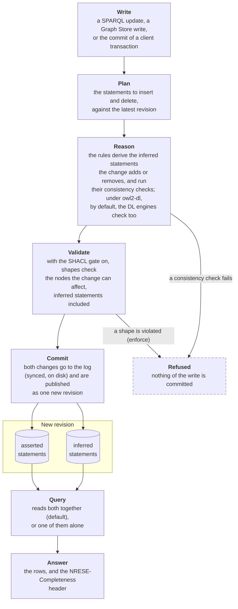

# NRESE

NRESE is an [RDF](https://www.w3.org/TR/rdf11-primer/) database with
[OWL](https://www.w3.org/TR/owl2-primer/) reasoning, written in Rust, for data you query
together with its ontology. It runs as one server with SPARQL endpoints and a browser console.

What it does that is its own:

- **Reasoning is part of the write.** With reasoning on, the statements your chosen rules
  derive from a write are computed in the write's own transaction and committed with it, as
  one revision. A bulk load recomputes them after loading instead.
- **Writes are checked before they commit.** Under OWL 2 QL, RL and DL, a write that fails
  a consistency check is refused, and nothing of it is committed. With the SHACL gate set to
  `enforce`, so is a write that introduces a shape violation.
- **Each answer says whether it is complete.** Every SPARQL query answer over HTTP has an
  `NRESE-Completeness` header: `complete`, or a status saying rows may be missing, with the
  reasons where the store knows them.
- **OWL 2 DL engines of its own.** In the `owl2-dl` mode, a hypertableau and a
  consequence-based engine check writes for consistency, classify the ontology, and add the
  query answers they can prove beyond what the rules derive.

A hobby project. Try it: [quick start](#quick-start). When to choose another system:
[limits](docs/limits.md).

## How a write becomes queryable

Where inferred statements come from, and when a query sees them (reasoning on):



Dashed: where a write ends without a commit; a write that times out before its commit ends
there too. One write runs at a time; until it commits, queries read the revision before it.
The steps in detail: [what a commit does](docs/what-it-covers.md#what-a-commit-does).

## What you can choose

| Feature | What it does | How you set or use it (default in **bold**) |
|---|---|---|
| [Reasoning](docs/what-it-covers.md#reasoning) | Derives statements from your data and ontology | `NRESE_REASONING_MODE`: **`disabled`**, `rdfs`, `rdfs-full`, `rdfs-plus`, `owl-horst`, `owl2-ql`, `owl2-rl`, `owl2-dl`; or `custom`, your own rules in Notation3 or `.pie`, which can also be added to any other mode but `disabled` |
| [Inferred statements](docs/ops/http-api.md#queries) | Kept apart from asserted ones, updated in each write's commit; a bulk load recomputes them afterwards | A query reads **both**, asserted only (`infer=false`), or inferred only (`FROM <http://www.ontotext.com/implicit>`) |
| [Consistency](docs/what-it-covers.md#what-a-commit-does) | Under `owl2-ql`, `owl2-rl` and `owl2-dl`, refuses a write that fails a consistency check | Under `owl2-dl`, `NRESE_DL_CONSISTENCY`: **`inline`** or `off`. A DL check that can't decide lets the write through, and the store's status says so |
| [Answer status](docs/what-it-covers.md#what-an-answer-promises) | `NRESE-Completeness` on every SPARQL query answer over HTTP: `complete`, `sound-only`, `unsound` or `not-certified` | Under `owl2-dl`, `dl-answers=exact` turns an answer that can't be proven complete into an error (422) |
| [Explanations](docs/ops/http-api.md#engine-api-apiv1) | Why a statement holds: the rules and premises that derive it | `GET /api/v1/repositories/{id}/explain` |
| [SHACL](docs/what-it-covers.md#shacl) | SHACL Core and SHACL-SPARQL, inferred statements included | On request: `/dataset/shacl`. On each write, `NRESE_SHACL_GATE`: **`off`**, `report` or `enforce` |
| [Named graphs](docs/what-it-covers.md#reasoning) | Statements live in named graphs or the default graph; rules read every graph and put inferences in the default graph | The default graph of a query, `NRESE_DEFAULT_GRAPH`: **`default`**, or `union` of all graphs |
| [Search](docs/what-it-covers.md#sparql) | Full-text (BM25), vector, and in part GeoSPARQL, inside SPARQL queries | Vectors are literals you supply; the store computes no embeddings |
| [Storage](docs/what-it-covers.md#storage-transactions-and-durability) | Its own engine: snapshots for readers, a write-ahead log, one writer at a time, read replicas | `NRESE_STORE_MODE`: **`in-memory`** or `on-disk` (the Docker image sets `on-disk`) |
| [Access](docs/what-it-covers.md#access-control-and-operations) | Authentication, and access per named graph | `NRESE_AUTH_MODE`: **`none`**, `bearer-static`, `bearer-jwt`, `oidc-introspection` or `mtls` |
| [Interfaces](docs/what-it-covers.md#interfaces) | SPARQL 1.1 Protocol, Graph Store Protocol, the RDF4J REST protocol (without `SNAPSHOT` and `SERIALIZABLE` isolation), an engine API described in OpenAPI | Several repositories per server, each with its own reasoning mode and rules |

## Quick start

You need git, Docker with BuildKit, curl, and port 8080 free. Rust and Node.js aren't
needed: the image builds the server and its console. The image's server needs an x86-64-v3
CPU (amd64) or a Neoverse N1 level CPU (arm64); for an older one, add
`--build-arg NRESE_TARGET_CPU=portable` to `docker build`. The commands are for a POSIX
shell: Linux, macOS, or Git Bash or WSL on Windows.

```bash
git clone https://github.com/Krarilotus/OWL-RS.git
cd OWL-RS
docker build -t nrese .
docker run -d --name nrese -p 127.0.0.1:8080:8080 -v nrese-data:/var/lib/nrese/data \
  -e NRESE_REASONING_MODE=owl2-rl -e NRESE_SHACL_GATE=enforce nrese
until curl -sf http://localhost:8080/readyz; do sleep 1; done
```

The last line waits until the server answers `{"status":"ready"}`. If it never does,
`docker logs nrese` shows the server's output ([startup errors](docs/ops/server-setup.md#startup-errors)).

The server keeps its data on the volume `nrese-data`, listens on this machine only, and has
no authentication on. It reasons under OWL 2 RL, with the SHACL gate set to `enforce` for the
[tutorial](docs/tutorial.md). The browser console is at `http://localhost:8080/console`.

### A first answer: inference

Store that every cat is an animal, and that Tom is a cat. The update prints nothing:

```bash
curl http://localhost:8080/dataset/update --data-urlencode 'update=
  PREFIX ex: <http://example.org/>
  PREFIX rdfs: <http://www.w3.org/2000/01/rdf-schema#>
  INSERT DATA { ex:Cat rdfs:subClassOf ex:Animal . ex:tom a ex:Cat }'
```

Ask for every animal:

```bash
curl -i http://localhost:8080/dataset/query --data-urlencode 'query=
  PREFIX ex: <http://example.org/>
  SELECT ?x WHERE { ?x a ex:Animal }'
```

```text
HTTP/1.1 200 OK
content-type: application/sparql-results+json
nrese-completeness: sound-only; regime=owl2-rl; reasons="rules: answers over the owl2-rl closure: …"

{"head":{"vars":["x"]},"results":{"bindings":[{"x":{"type":"uri","value":"http://example.org/tom"}}]}}
```

- `ex:tom` is in the answer because the update's commit also stored the inferred statement
  `ex:tom a ex:Animal`.
- `sound-only` says rows may be missing. The reason here: the answers come from the OWL 2 RL
  rules, not from every answer OWL 2 DL entails
  ([what an answer promises](docs/what-it-covers.md#what-an-answer-promises)).

Ask again, for asserted statements only:

```bash
curl -i http://localhost:8080/dataset/query --data-urlencode 'query=
  PREFIX ex: <http://example.org/>
  SELECT ?x WHERE { ?x a ex:Animal }' --data infer=false
```

```text
HTTP/1.1 200 OK
content-type: application/sparql-results+json
nrese-completeness: complete

{"head":{"vars":["x"]},"results":{"bindings":[]}}
```

No animal was asserted, so there are no rows. No reasoning was involved, so the answer is
`complete`. In both outputs other headers are left out, and `…` marks shortened text.

The [tutorial](docs/tutorial.md) goes on from here: retraction, validation,
[your own data](docs/tutorial.md#your-own-data), a changed setting, and starting over.

Without Docker, from source with Rust: [getting started](docs/dev/getting-started.md#run-the-server).

## How it is built

The workspace is split into crates by what they own. Dependencies point down only: a
crate may use a crate in a lower layer, or one placed below it in its own layer, never
one above. Each crate's `lib.rs` opens with what
it owns. [ARCHITECTURE.md](docs/ARCHITECTURE.md) follows a write and a query from
request to answer, names for each concept its page and its code, and says at which layer
each kind of problem is fixed; the decisions behind it, with their reasons, are in
[adr/](docs/adr/README.md). Which crates can be used on their own, and what each one uses:
[crates](docs/ARCHITECTURE.md#24-dependencies-and-using-a-crate-on-its-own).

## Documentation

| To | Read |
|---|---|
| Go on from the quick start | [tutorial](docs/tutorial.md) |
| Know what it does, with each part's limits | [what it covers](docs/what-it-covers.md) |
| Know what changed since `main`, and what is slower | [release notes, 1.5 (prerelease)](docs/releases/v1.5.md) |
| Build, run and develop | [getting-started.md](docs/dev/getting-started.md), [CONTRIBUTING.md](CONTRIBUTING.md) |
| Deploy, load data, back up | [server-setup.md](docs/ops/server-setup.md) |
| Look up an endpoint or a setting | [http-api.md](docs/ops/http-api.md), [config-reference.md](docs/ops/config-reference.md) |
| Fix an error | [startup errors](docs/ops/server-setup.md#startup-errors), [status codes](docs/ops/http-api.md#status-codes) |
| Know what reasoning computes | [reasoning-semantics.md](docs/spec/reasoning-semantics.md) |
| Understand the design | [ARCHITECTURE.md](docs/ARCHITECTURE.md), [design/](docs/design/), the decisions in [adr/](docs/adr/) |
| Find any other document | [docs/README.md](docs/README.md) |

## State and limits

Which commit these pages describe: `git log -1` in your clone, or the commit GitHub shows
beside the file. A running server names its build at `/version`: `version`, the package version, and with reasoning on `reasoning_semantics`,
the ruleset with its semantics version and a fingerprint of what it derives
([reasoning-semantics.md](docs/spec/reasoning-semantics.md)).

Changes that affect stored data, answers or clients, with their dates and what to do:
[dated changes](docs/STATUS.md#dated-changes). What is in, what is left out and when to choose
another system, and what is planned: the [scope](docs/what-it-covers.md#scope). The
contributors' record of what is done and open, item by item: [docs/STATUS.md](docs/STATUS.md).

Platforms: the image for `linux/amd64` and `linux/arm64`; the merge checks also build and
test on Windows ([scripts/check.sh](scripts/check.sh)). Stopping, and what a crash or a kill
keeps: [stopping](docs/ops/server-setup.md#64-stopping),
[durability](docs/spec/02-storage-and-transactions.md#durability-on-disk-mode); backups and
restores: [server setup](docs/ops/server-setup.md#10-backup-and-recovery-setup),
[drills](docs/ops/backup-restore-drills.md).

## Thanks

Many of NRESE's ideas come from the research literature and from systems such as QLever,
Konclude, HermiT and RDFox. Its first prototype was built on Oxigraph. Thanks to their
authors.

## Licence

Copyright (C) 2026 Krarilotus. Licensed under either of the
[Apache License, Version 2.0](LICENSE-APACHE) or the [MIT licence](LICENSE-MIT), at your
option. The v1 prototype published before October 2026 (`main` up to `8088e9a`) carried
`Apache-2.0` in its package metadata; that statement stands for those commits.
Third-party material keeps its own licence: the dependencies (MIT, Apache-2.0, BSD and
similar; the accepted licences are in [deny.toml](deny.toml)), the vendored vocabularies
(sources and terms in [their README](benches/nrese-bench-harness/fixtures/catalog-cache/README.md)),
the rule file under `benches/reasoning/nemo/sparq/` ([its licence](benches/reasoning/nemo/sparq/LICENSE)),
and the W3C test suites, which are fetched and not part of this repository.
Contributions come in under the same terms: [CONTRIBUTING.md](CONTRIBUTING.md).
