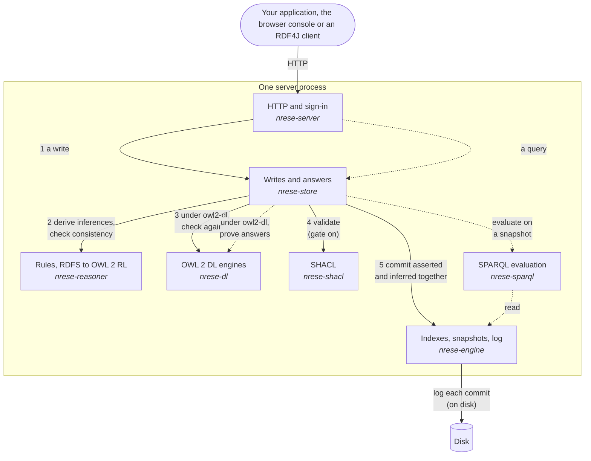

# NRESE

NRESE is an RDF database with OWL reasoning, written in Rust. Its inferences are committed with
the write they follow from and kept apart from what you stored, and every query answer carries a
status that says whether rows may be missing.

Most work with data comes down to organising and standardising it, and an ontology is where
that is written down. We wanted a store that follows the ontology itself, so that a write is
checked against it, an inference changes with the data, and an answer says how far it can be
trusted. NRESE is a hobby project, built part by part from the research literature with the W3C
test suites as its floor, and where a standard could go further for a use case, we want to help
move it.

## What it does

- **Reasoning from RDFS to OWL 2 DL.** Off until you choose a mode: RDFS, OWL 2 QL, RL and DL, a
  few rule sets in between, or your own rules ([modes](docs/spec/reasoning-semantics.md#modes)).
- **Inferences are part of the commit.** A write and what follows from it become visible in the
  same revision, and a delete takes along the inferences that no longer follow. Bulk loads and
  imports are the exception: their inferences follow in the next revision
  ([what a commit does](docs/what-it-covers.md#what-a-commit-does)).
- **Asserted and inferred are kept apart.** A query reads both, or only one of them
  ([queries](docs/ops/http-api.md#queries)).
- **Writes that break the data are refused.** Under the OWL 2 modes, a SPARQL update, Graph Store
  write or transaction is refused as a whole when the consistency check finds it would make the
  data inconsistent, and with the SHACL gate set to `enforce`, when it violates a shape. The
  response gives the reason, as far as the writer may read the data behind it.
- **Every answer carries a status.** `complete`, `sound-only` (rows may be missing), `unsound`
  (rows may be missing or wrong) or `not-certified`, in a header on every query answer over HTTP
  ([what an answer promises](docs/what-it-covers.md#what-an-answer-promises)).
- **Ask why.** For anything the rules derived, you get its derivation from your statements, rule
  by rule, within a [size limit](docs/limits.md#reasoning) ([explanations](docs/ops/http-api.md#engine-api-apiv1)).
- **Inferences respect read rights.** A reader who may see only some named graphs can be shown
  just the inferences that follow from those graphs
  ([access control](docs/ops/http-api.md#graph-level-access-control)).
- **OWL 2 DL engines of its own.** Under `owl2-dl`, a hypertableau and a consequence-based
  reasoner check consistency, classify the ontology and prove query answers beyond the rules
  ([design](docs/design/owl2-dl.md)).

Around that it has what a database needs: its own storage engine, in memory or on disk with a
write-ahead log, named graphs with read and write rights per graph, sign-in by token, OIDC or
a client certificate checked by your TLS proxy, full-text, vector and geospatial search inside SPARQL, backups with
point-in-time restore, read replicas, and several repositories per server. All of it, with its
limits, is in [features and standards](docs/what-it-covers.md).

## Standards

Each suite below runs in our checks, which fail when its data is missing. The counts are what the
[release gate](benches/fast/w3c-expected.toml) requires to pass, with no failure allowed, and a
test we are known to fail is listed with its reason beside its runner.

| Standard | What NRESE does | Tests |
|---|---|---|
| [SPARQL 1.1](https://www.w3.org/TR/sparql11-overview/) [Query](https://www.w3.org/TR/sparql11-query/), [Update](https://www.w3.org/TR/sparql11-update/), [Federated Query](https://www.w3.org/TR/sparql11-federated-query/) | All of it, with the [deviations listed](docs/limits.md#sparql) | 505 W3C tests, no known failure ([runner](crates/nrese-sparql/tests/w3c_sparql11)) |
| [SPARQL 1.1 Protocol](https://www.w3.org/TR/sparql11-protocol/), [Graph Store Protocol](https://www.w3.org/TR/sparql11-http-rdf-update/), [Service Description](https://www.w3.org/TR/sparql11-service-description/) | Served at `/dataset/…` ([HTTP interface](docs/ops/http-api.md)) | Our own ([protocol](crates/nrese-server/tests/it/query_protocol_tests.rs), [Graph Store](crates/nrese-server/tests/it/graph_store_api_tests.rs)) |
| Results as [JSON](https://www.w3.org/TR/sparql11-results-json/), [XML](https://www.w3.org/TR/rdf-sparql-XMLres/), [CSV and TSV](https://www.w3.org/TR/sparql11-results-csv-tsv/) | Written, and read but for CSV | The SPARQL suites read JSON, XML and TSV and check the CSV writer, and [round trips](crates/rdf/nrese-sparql-results/tests/round_trip_tests.rs) check the others |
| [Turtle](https://www.w3.org/TR/turtle/), [TriG](https://www.w3.org/TR/trig/), [N-Triples](https://www.w3.org/TR/n-triples/), [N-Quads](https://www.w3.org/TR/n-quads/), [RDF/XML](https://www.w3.org/TR/rdf-syntax-grammar/) | Read and written, RDF 1.1 and the RDF 1.2 drafts | RDF 1.1 and 1.2 syntax suites, [runner](crates/rdf/nrese-rdf-io/tests/w3c_rdf) |
| [JSON-LD 1.1](https://www.w3.org/TR/json-ld11/) | Read and written, remote contexts not fetched | `toRdf`, `expand`, `fromRdf`, [runner](crates/rdf/nrese-rdf-io/tests/w3c_jsonld) |
| [RDF Dataset Canonicalization](https://www.w3.org/TR/rdf-canon/) | RDFC-1.0 | [runner](crates/rdf/nrese-rdf-io/tests/w3c_rdfc) |
| [SPARQL 1.2](https://www.w3.org/TR/sparql12-query/) and [RDF 1.2](https://www.w3.org/TR/rdf12-concepts/) drafts | Triple terms and directional strings | 269 W3C tests, no known failure |
| [RDF Schema 1.1](https://www.w3.org/TR/rdf11-schema/) | Its entailment rules, with the [few left out](docs/spec/reasoning-semantics.md#modes) listed | No W3C suite run |
| [OWL 2 RL](https://www.w3.org/TR/owl2-profiles/#OWL_2_RL) | The OWL 2 RL/RDF rules, materialised and maintained with each write | 86 W3C test cases, 7 of them passed only under `owl2-dl`, and 3 skipped whose premise is in no RDF syntax or imports another ontology ([runner](crates/nrese-store/tests/w3c_owl2_rl)) |
| [OWL 2 QL](https://www.w3.org/TR/owl2-profiles/#OWL_2_QL) | Rules plus query rewriting | W3C test cases, [9 known failures](crates/nrese-store/tests/w3c_owl2_ql/expected-failures.txt) |
| [OWL 2 DL](https://www.w3.org/TR/owl2-direct-semantics/) | Consistency, classification, realisation, proven answers | 410 W3C test cases answered as expected, and [1 whose expected answer is wrong](crates/nrese-dl/tests/tableau_w3c/disputed.txt), shown by a model ([runner](crates/nrese-dl/tests/tableau_w3c)) |
| [SHACL](https://www.w3.org/TR/shacl/) Core and SHACL-SPARQL | On request, or as a gate on writes | 98 Core and 22 SHACL-SPARQL W3C tests, no known failure ([runner](crates/nrese-shacl/tests/w3c_shacl)) |
| [GeoSPARQL 1.1](https://docs.ogc.org/is/22-047r1/22-047r1.html) | In part: functions and relations over WKT, GeoJSON and simple GML | 194 of the 212 compliance tests, 18 disputed with the reference ([runner](crates/nrese-sparql/tests/geosparql_compliance)) |
| [RDF4J REST protocol](https://rdf4j.org/documentation/reference/rest-api/) | Served at `/repositories/…`, so RDF4J clients and tools connect | Our own ([protocol](crates/nrese-server/tests/it/rdf4j_protocol_tests.rs), [clients](crates/nrese-server/tests/it/client_compat_tests.rs)) |

What is left out, and the deviations with what to do instead: [limits](docs/limits.md).

## How it fits together



Solid arrows are a write, numbered in the order its steps run, and dashed arrows are a query.
If a step refuses the write, nothing of it is committed. A query reads a snapshot, so it doesn't
wait for a write to finish, and the store gives its answer a status. Each box names its crate,
and below them all are the crates they build on: the RDF model and syntaxes, the OWL 2 model,
joins and memory budgets, and vector indexes. [Architecture](docs/ARCHITECTURE.md) has the
layers, what each crate owns and which crates you can use on their own.

## Quick start

You need git, Docker with BuildKit, curl, a POSIX shell (Linux, macOS, or Git Bash or WSL on
Windows) and a free port 8080. The image builds the server and its browser console, so you need
no Rust or Node.js, and the first build takes several minutes. These pages describe the branch
`refactor/engine-v2`, where version 1.5 is prepared, and `main` still holds the earlier version.

```bash
git clone --branch refactor/engine-v2 https://github.com/Krarilotus/OWL-RS.git
cd OWL-RS
docker build -t nrese .
docker run -d --name nrese -p 127.0.0.1:8080:8080 -v nrese-data:/var/lib/nrese/data \
  -e NRESE_REASONING_MODE=owl2-rl -e NRESE_SHACL_GATE=enforce nrese
until curl -sf http://localhost:8080/readyz; do sleep 1; done
```

The server now listens on this machine only, without sign-in, reasons under OWL 2 RL, refuses
writes that violate a SHACL shape, and keeps its data on the volume `nrese-data`. The console is at
<http://localhost:8080/console>. If `docker run` itself fails, its name or port is taken; if the
last line never returns, `docker logs nrese` shows why
([startup errors](docs/ops/server-setup.md#startup-errors)). The image targets x86-64-v3 and
Neoverse N1 CPUs, and on an older CPU you build with `--build-arg NRESE_TARGET_CPU=portable`.

### A first answer

Store that every cat is an animal, and that Tom is a cat:

```bash
curl http://localhost:8080/dataset/update --data-urlencode 'update=
  PREFIX ex: <http://example.org/>
  PREFIX rdfs: <http://www.w3.org/2000/01/rdf-schema#>
  INSERT DATA { ex:Cat rdfs:subClassOf ex:Animal . ex:tom a ex:Cat }'
```

Ask for every animal:

```bash
curl -i http://localhost:8080/dataset/query --data-urlencode 'query=
  PREFIX ex: <http://example.org/>
  SELECT ?x WHERE { ?x a ex:Animal }'
```

```text
HTTP/1.1 200 OK
content-type: application/sparql-results+json
nrese-completeness: sound-only; regime=owl2-rl; reasons="rules: answers over the owl2-rl closure: …"

{"head":{"vars":["x"]},"results":{"bindings":[{"x":{"type":"uri","value":"http://example.org/tom"}}]}}
```

Tom is an animal because the update's commit also stored the inferred statement
`ex:tom a ex:Animal`. The status is `sound-only`: every row is right, but the answer
comes from the OWL 2 RL rules, which may miss answers that full OWL 2 DL would give. Ask again with `--data infer=false` and you
read only what you stored: no rows, and the status is `complete`.

The [tutorial](docs/tutorial.md) goes on from here with a delete, a refused write, your own data
and a changed setting. To build from source instead, see
[getting started](docs/dev/getting-started.md#run-the-server).

## Documentation

| To | Read |
|---|---|
| Learn it step by step | the [tutorial](docs/tutorial.md) |
| See all it does, and the standards it follows | [features and standards](docs/what-it-covers.md) |
| Know where it stops, and what to do instead | [limits](docs/limits.md) |
| Know what reasoning computes, and what an answer promises | [reasoning](docs/spec/reasoning-semantics.md) |
| Load your own data | [your own data](docs/tutorial.md#your-own-data), and large files [offline](docs/ops/server-setup.md#loading-data) |
| Call it over HTTP | [the HTTP interface](docs/ops/http-api.md) |
| Change a setting | [every setting](docs/ops/config-reference.md) |
| Run it for others | [running a server](docs/ops/server-setup.md), [backups](docs/ops/backups.md), [read replicas](docs/ops/replication.md) |
| Understand an error | [status codes](docs/ops/http-api.md#status-codes), [startup errors](docs/ops/server-setup.md#startup-errors) |
| Look up a word | the [glossary](docs/glossary.md) |
| Build it from source, or use a crate on its own | [getting started](docs/dev/getting-started.md), [the crates](docs/ARCHITECTURE.md#24-dependencies-and-using-a-crate-on-its-own) |
| See what changed | the [release notes](docs/releases/v1.5.md) |
| Work on NRESE | [contributing](CONTRIBUTING.md), the [architecture](docs/ARCHITECTURE.md) and the [contributors' map](docs/README.md) |

## Licence

Copyright (C) 2026 Krarilotus. Licensed under either of the
[Apache License, Version 2.0](LICENSE-APACHE) or the [MIT licence](LICENSE-MIT), at your
option. The v1 prototype published before October 2026 (`main` up to `8088e9a`) carried
`Apache-2.0` in its package metadata; that statement stands for those commits.
Third-party material keeps its own licence: the dependencies (MIT, Apache-2.0, BSD and
similar; the accepted licences are in [deny.toml](deny.toml)), the vendored vocabularies
(sources and terms in [their README](benches/nrese-bench-harness/fixtures/catalog-cache/README.md)),
the rule file under `benches/reasoning/nemo/sparq/` ([its licence](benches/reasoning/nemo/sparq/LICENSE)),
and the W3C test suites, which are fetched and not part of this repository.
Contributions come in under the same terms: [CONTRIBUTING.md](CONTRIBUTING.md).
