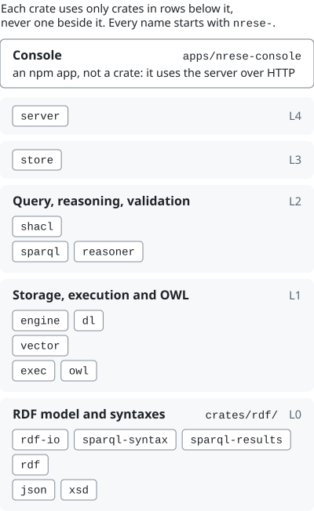

# NRESE Architecture (Engine v2)

This page says which layer owns which concern, which way dependencies may point and, most important for day-to-day work, at which layer a kind of problem is fixed. The specs under `docs/spec/` refine single concerns, and where one contradicts this page, this page wins and the spec is corrected.

Decisions with lasting consequences are recorded as ADRs in [`docs/adr/`](adr/). Like every page here, this one describes the version it comes with, not a plan or another version. What NRESE covers today is in [features and standards](what-it-covers.md), and what is planned is in [ROADMAP.md](ROADMAP.md).

## 1. Product target

NRESE is an RDF database with reasoning built in, run as one server that uses every core of its
machine. What it does is in [features and standards](what-it-covers.md), and the
[README's picture](../README.md#how-it-fits-together) shows the parts a write and a query pass
through. This page is for changing it: who owns what, which way dependencies point, and where a
problem is fixed.

Correctness and speed are measured with the harness in `benches/nrese-bench-harness` and the
benchmark kits in [`benches/`](../benches/README.md).

## 2. Layer model

Dependencies point downwards only. A crate may use the public API of a crate below it in this picture (a lower layer, or a lower row of its own layer), but never another crate's internals and never one above. The picture is the order of the manifests' `[dependencies]`, and test-only dev-dependencies aren't shown.

<picture>
  <source media="(prefers-color-scheme: dark)" srcset="img/layers-dark.svg">
  
</picture>

Outside the layer model are `nrese-sparql-reference` (the SPARQL evaluator written from the specification, the oracle of the differential tests, used by tests only), `nrese-fuzz` (fuzz targets for every parser of untrusted input) and `benches/` (the benchmark kits).

### 2.1 Crate ownership

| Crate | Owns | Must not own |
|---|---|---|
| `crates/rdf/` | The RDF model (`nrese-rdf`: IRIs, terms, quads, canonicalisation), every RDF syntax (`nrese-rdf-io`), SPARQL syntax and algebra (`nrese-sparql-syntax`), the results formats (`nrese-sparql-results`), XSD values and the OWL 2 datatype map (`nrese-xsd`), JSON (`nrese-json`). | Storage, evaluation, reasoning. |
| `nrese-engine` | Term model and dictionary encoding (`TermId`), quad indexes in all needed permutations, LSM runs and compaction, MVCC snapshots, the commit protocol, the write-ahead log and checkpoints, bulk load, cardinality statistics, the full-text and vector indexes over its literals. | SPARQL semantics, RDF syntax parsing, validation or reasoning rules, HTTP. |
| `nrese-exec` | Id-level tables, joins, grouping, graph closures and capacity accounting (the server's budget, each request's envelope) with its one RAII reservation type; the DL batch-width handle (`Workers`). It never decodes a term and depends on no NRESE crate. | Term values, storage, SPARQL or rule semantics; server-wide admission policy. |
| `nrese-vector` | Vector literals' distances and indexes (exact scan, HNSW). | Terms, storage, SPARQL. |
| `nrese-owl` | The OWL 2 structural model read from RDF or the functional syntax, its diagnostics, the profile checker, the normaliser into DL-clauses (automata for role inclusions, lazy definitions), the OWL 2 QL schema compiler and the proof IR (justifications). | Search, storage, rule evaluation. |
| `nrese-dl` | The OWL 2 DL engines over `nrese-owl`'s clauses: context saturation, tableau search and immutable compiled probes with fresh search state, portfolio, classification and realisation. | Storage, SPARQL, HTTP; when to run (the store and reasoner decide), query-to-assumption adaptation. |
| `nrese-sparql` | SPARQL 1.1 query and update evaluation over an engine snapshot: the native executor (the only one) and its planner (EXPLAIN), the result cache of plan parts (its keys are plan parts, its entries id tables, and only the executor knows what a part's result depends on), query cancellation, dataset specification (`FROM`, protocol `default-graph-uri`), update-to-delta planning, result serialisation; the OWL 2 QL rewriting of queries, full-text, vector and GeoSPARQL search. | Commit decisions, validation, persistence, HTTP; the cache's instance and budget (the store's, as with the query memory budget). |
| `nrese-reasoner` | Reasoning profiles, rule sets, materialisation, incremental maintenance, consistency checks, explanations. | Storage layout, HTTP, SHACL. |
| `nrese-shacl` | Shapes-graph compilation, SHACL Core and SHACL-SPARQL validation, incremental validation scoped to a delta, validation reports. It reads through `nrese-sparql`'s `ReadView` and uses its value semantics, because SHACL defines its constraints through SPARQL's operators; `nrese-sparql` never depends on it ([design/shacl.md](design/shacl.md)). | Storage layout, reasoning, HTTP, when to validate and what a failure means for a commit. |
| `nrese-store` | Product operations and the **mutation pipeline** (plan → validate → commit), gates, revision reporting and preload; the bulk loader and the quarantine of statements it can't read (re-admitted through the pipeline); one result cache per store; the catalog's shared native query budget (`Runtime`); DL bound orchestration, candidate adaptation and completeness. | HTTP status codes, authentication backends (tokens, OIDC) and request parsing; what a cached result is keyed by; generic execution kernels. It does own the access state: principals, workspaces and policies, and the local users' Argon2id password hashes with their verification and throttling, which are durable data of the system store ([ADR-0008](adr/0008-users-workspaces-policies.md), `access/login.rs`); the server maps a request's credentials to a principal. |
| `nrese-server` | Routes, content negotiation, auth backends, policy (limits, timeouts, rate limits), deployment posture, operator/console hosting, AI suggestions, mapping store errors to HTTP. | Any data semantics. It never touches the engine directly. |

Queries execute on their caller; parallel kernels run on Rayon's global pool. The store's
`Runtime` owns the catalog-wide budget, which each request draws on through one envelope,
and `Workers` sets the width of DL candidate batches and of result encoding. The other parallel kernels
(joins, sorts, closures) use the whole pool, as nested Rayon work doesn't inherit a narrower
handle. Resource lifetimes, reservations and the kernel boundary are in
[execution-core.md](design/execution-core.md#execution-and-resource-lifetime).

### 2.2 Data flow

On a read, `server` parses and authorises the request, and `store::query` takes a snapshot. The snapshot is an `Arc` clone of the latest version, read under a lock held only while a commit publishes, so nothing waits for a commit, compaction or checkpoint to finish. `sparql` evaluates against the snapshot with a cancellation token and charges what it holds to the request's memory envelope (`budgets.query_memory`, and `413` past it). The envelope draws on the budget of all queries (`budgets.total_query_memory`) inside the process's (`budgets.process_memory`), and with no room in either the answer is `503`. The results are serialised, and `server` sends the response.

Writes go through the mutation pipeline, which `nrese-store` owns, and every public write enters there. That is the protocols' commands, and `MutationCommand::Delta` with a `DeltaPlanner` for any other front-end (a GQL or Cypher update), which plans its delta into the transaction and is gated like the rest. The store has no public method that commits around the pipeline (`write_path_tests`). Its own writes to its system graphs and scratch stores are crate-private (`*_ungated`), and bulk loads, rematerialisation and a replica's log are explicit operations of their own.
1. Acquire the single writer slot and a snapshot of the latest revision.
2. Turn the request into a `Delta` (exact inserts and deletes relative to the snapshot). For SPARQL Update this evaluates `WHERE` clauses against *snapshot + pending delta*, so later operations in a request see earlier ones. Nothing is written.
3. The gates run against `(snapshot, delta)`. With reasoning on, the reasoner first derives the inferred delta and checks consistency, under `owl2-dl` the DL engines check it too, and then SHACL validates where its gate is on. Reasoning that would take the process past `budgets.process_memory` stops with an error (`500`), and nothing is committed. The gates are *delta-aware*, and a gate that can't be incremental says so explicitly in its capability report.
4. If the request's deadline has passed or it was cancelled, abort. Nothing is committed after a timeout.
5. The engine writes the asserted and inferred deltas to the WAL (durable mode), appends it as a new immutable run, and publishes the new version atomically. Revisions are persistent and monotonic. In on-disk mode the commit is acknowledged only after its WAL record is synced, so an acknowledged commit survives a crash or a power loss. A record that a crash left torn was never acknowledged, and it is cut at the next start ([durability](spec/02-storage-and-transactions.md#durability-on-disk-mode)).
6. After the commit, background compaction and checkpoints run. Reasoning is *not* post-commit: inferences are committed with the write that causes them, under the same revision ([design/reasoner-v2.md](design/reasoner-v2.md) §2.1).

The cost of steps 2 to 5 is proportional to the delta, not the dataset. Any change that reintroduces work proportional to the dataset on the write path must be justified in an ADR. One case is open: splitting an equality class can fall back to work over the whole dataset while it holds the writer ([open work](STATUS.md#open-work)).

A bulk load, `nrese-server load`, bypasses the pipeline. The engine writes the quads, and with
reasoning on the reasoner then recomputes the inferences and runs the rules' consistency checks
([what a commit does](what-it-covers.md#what-a-commit-does)).

### 2.3 Concepts: where each is explained and where its code is

| Concept | Explained in | Code |
|---|---|---|
| Storage, snapshots, durability | [storage contract](spec/02-storage-and-transactions.md), §4 | `crates/nrese-engine/src/lib.rs`, `crates/nrese-engine/src/durability/mod.rs` |
| A commit and its gates | [what a commit does](what-it-covers.md#what-a-commit-does), §2.2 | `crates/nrese-store/src/mutation/mod.rs` |
| SPARQL query and update | [HTTP interface](ops/http-api.md#sparql), §5 | `crates/nrese-sparql/src/lib.rs` |
| What an answer promises | [features and standards](what-it-covers.md#what-an-answer-promises) | `crates/nrese-sparql/src/completeness.rs` |
| Reasoning modes and rules | [reasoning semantics](spec/reasoning-semantics.md) | `crates/nrese-reasoner/src/lib.rs`; when it runs: `crates/nrese-store/src/reasoning.rs` |
| OWL 2 DL | [design](design/owl2-dl.md) | `crates/nrese-dl/src/lib.rs`, `crates/nrese-owl/src/lib.rs`, `crates/nrese-store/src/dl/mod.rs` |
| SHACL | [design](design/shacl.md), [HTTP interface](ops/http-api.md#shacl-validation) | `crates/nrese-shacl/src/lib.rs`, `crates/nrese-store/src/shacl.rs` |
| Access control | [HTTP interface](ops/http-api.md#graph-level-access-control), [ADR-0008](adr/0008-users-workspaces-policies.md) | `crates/nrese-store/src/access/mod.rs` |
| Memory limits | [budgets](ops/config-reference.md#budgets) | `crates/nrese-store/src/runtime.rs`, `crates/nrese-exec/src/budget.rs` |
| Bulk load, quarantine | [loading data](ops/server-setup.md#loading-data), [quarantine](design/quarantine.md) | `crates/nrese-store/src/bulk_load.rs`, `crates/nrese-store/src/quarantine.rs` |
| Backups | [backups](ops/backups.md) | `crates/nrese-store/src/backup.rs` |
| Read replicas | [replication](ops/replication.md) | `crates/nrese-server/src/replication.rs` |
| Configuration | [configuration reference](ops/config-reference.md) | `crates/nrese-server/src/config.rs` |
| HTTP endpoints and errors | [HTTP interface](ops/http-api.md) | `crates/nrese-server/src/http/mod.rs` |
| RDF syntaxes | [features and standards](what-it-covers.md#rdf-syntaxes) | `crates/rdf/nrese-rdf-io/src/lib.rs` |

### 2.4 Dependencies, and using a crate on its own

The table gives every direct dependency of each crate, test-only ones left out. The picture in §2
shows the layers, and §2.1 what each crate owns. None of the crates is on crates.io
(`publish = false`), and none promises a stable API yet. "On its own" says whether a
crate's job stands without the rest of the stack, and to use one, take it as a git dependency
pinned to a commit. Their API reference isn't published, but `cargo doc -p CRATE --open` builds
it from a checkout, and each crate's `lib.rs` opens with what the crate owns.

| Crate | Uses | On its own |
|---|---|---|
| [`nrese-xsd`](../crates/rdf/nrese-xsd) | – | Yes |
| [`nrese-json`](../crates/rdf/nrese-json) | – | Yes |
| [`nrese-rdf`](../crates/rdf/nrese-rdf) | `nrese-xsd` (optional) | Yes |
| [`nrese-rdf-io`](../crates/rdf/nrese-rdf-io) | `nrese-rdf`, `nrese-json` | Yes |
| [`nrese-sparql-syntax`](../crates/rdf/nrese-sparql-syntax) | `nrese-rdf` | Yes |
| [`nrese-sparql-results`](../crates/rdf/nrese-sparql-results) | `nrese-rdf`, `nrese-json` | Yes |
| [`nrese-exec`](../crates/nrese-exec) | – | Yes: knows no terms |
| [`nrese-vector`](../crates/nrese-vector) | `nrese-exec` | Yes |
| [`nrese-owl`](../crates/nrese-owl) | – | Yes: works over the caller's term ids |
| [`nrese-dl`](../crates/nrese-dl) | `nrese-owl`, `nrese-exec`, `nrese-xsd` | Yes, with example command-line tools |
| [`nrese-engine`](../crates/nrese-engine) | `nrese-rdf`, `nrese-exec`, `nrese-vector` | Yes: a quad store without SPARQL |
| [`nrese-sparql`](../crates/nrese-sparql) | `nrese-engine`, `nrese-exec`, `nrese-owl`, `nrese-rdf`, `nrese-xsd`, `nrese-sparql-syntax`, `nrese-sparql-results` | With `nrese-engine` |
| [`nrese-reasoner`](../crates/nrese-reasoner) | `nrese-engine`, `nrese-exec`, `nrese-owl`, `nrese-rdf`, `nrese-rdf-io`, `nrese-xsd` | With `nrese-engine` |
| [`nrese-shacl`](../crates/nrese-shacl) | `nrese-engine`, `nrese-exec`, `nrese-sparql`, `nrese-sparql-syntax`, `nrese-rdf`, `nrese-xsd` | With `nrese-engine` and `nrese-sparql` |
| [`nrese-store`](../crates/nrese-store) | every crate above but `nrese-vector` and `nrese-json`, which it reaches through others | Yes: everything but HTTP |
| [`nrese-server`](../crates/nrese-server) | `nrese-store`, `nrese-sparql`, `nrese-reasoner`, `nrese-exec`, `nrese-rdf`, `nrese-rdf-io`, `nrese-xsd`, `nrese-sparql-results` | The binary |
| [`apps/nrese-console`](../apps/nrese-console) | the HTTP API only | With a server |

## 3. Where to fix what

Fix a problem at the lowest layer that owns the concept, and nowhere else. Workarounds in a higher layer are defects.

| Symptom | Owning layer | Not here |
|---|---|---|
| Wrong result of a triple pattern, a missing quad after commit, a lost write after restart | `nrese-engine` | Filtering in SPARQL or server code |
| Wrong SPARQL semantics (joins, `OPTIONAL`, `FILTER`, update operation behaviour, dataset clauses) | `nrese-sparql` | Rewriting queries in the server |
| A query is slow because of the access path or join order | `nrese-sparql` (planner/executor) or `nrese-engine` (index, statistics) | Caching responses in the server |
| A write is slow | `nrese-engine` (commit, runs) or the offending gate | Raising timeouts |
| Wrong or missing inference, a false consistency reject | `nrese-reasoner` | Post-filtering in the store |
| Wrong SHACL result | `nrese-shacl` | Special-casing in the pipeline |
| Gate order, "what counts as a commit", timeout-vs-commit semantics, revision numbering | `nrese-store` (mutation pipeline) | HTTP handlers |
| HTTP status, media types, auth, limits, rate limiting | `nrese-server` | Store or engine |
| Operator-visible configuration knob | Typed config struct in the owning crate; env/file parsing only in `nrese-server/src/config/` | Ad hoc `std::env::var` anywhere else |

Each crate's `lib.rs` starts with a short module doc restating its ownership. When a PR touches two layers for one bug, the description must say which layer the root cause was in.

## 4. Engine design (L1)

See [ADR-0002](adr/0002-engine-storage-lsm-permutations.md) for the full rationale.

- Terms are encoded as 64-bit `TermId`s. The top bits carry the term kind: IRI, blank node, literal, and inline values for canonical `xsd:integer` and the types derived from it, `xsd:boolean`, `xsd:decimal`, `xsd:date` and `xsd:dateTime` (within ranges). A value is only inlined if its lexical form is canonical, so `"01"^^xsd:integer` and `"1"^^xsd:integer` stay distinct terms. This is RDF-correct, unlike folding equal values into one term. Everything else goes through a dictionary (SwissTable hash index over one string arena).
- Quads are `[TermId; 4]` in seven permutations: `SPOG POSG OSPG` answer patterns with an unbound graph, and `GSPO GPOS GOSP` answer patterns with a bound graph (including the default graph, `TermId::DEFAULT_GRAPH`). Every triple pattern is a contiguous range scan in one of them. The seventh, `GPSO`, gives executors `(?s p ?o)` sorted by subject for star joins (XC1). Data that is all in the default graph keeps four, `SPOG POSG OSPG PSOG`, until a named graph arrives ([storage contract](spec/02-storage-and-transactions.md)). The inferred stack keeps `SPOG POSG OSPG PSOG`. `Snapshot::count_in` is exact: range bounds suffice for tombstone-free runs; tombstones add bitmap counts, and equality expansion or post-filtered access paths can require scanning. `Snapshot::scan_sorted_in` returns a scan in a requested order.
- The index is log-structured: a stack of immutable sorted runs, oldest (largest) first. A commit appends one small run containing inserts and tombstones. Reads k-way merge the runs covering a range (newest wins). A size-tiered compaction policy keeps O(log N) runs, with O(log N) amortised merge work per quad. Large merges run off the write path.
- For MVCC, a snapshot is an `Arc` of the run list plus the revision. Readers never block writers or each other. A snapshot stays valid for as long as it's held.
- Durability comes from a redo-only write-ahead log (length + CRC32 per record, fsync policy configurable) and periodic checkpoints (atomic write-rename). Recovery is the latest checkpoint plus WAL replay. A torn tail is cut (its bytes kept), and other damage refuses to open unless configured otherwise. There's no RocksDB, so there's no native toolchain dependency.

## 5. Evaluation, reasoning, validation (L2)

- For SPARQL, the native executor evaluates every query and update (merge, hash and index joins on permutation order, worst-case-optimal joins for cyclic patterns, vectorised ID tables); `nrese-sparql-syntax` parses. Its correctness oracle in tests is `nrese-sparql-reference`, an evaluator written straight from the specification's algebra. Since step 5 of the [migration plan](design/rdf-bundle.md) the engine runs on the RDF bundle of our own under `crates/rdf/` (terms, XSD values, all RDF syntaxes, SPARQL syntax and results formats) and no longer depends on any Oxigraph library ([ADR-0001](adr/0001-own-engine-reuse-oxigraph-parsers.md) as amended).
- Reasoning ([ADR-0003](adr/0003-materialised-reasoning.md)) is semi-naive datalog materialisation of RDFS / OWL 2 RL rule sets over `TermId`s, with `owl:sameAs` handled by union-find rewriting, and incremental maintenance for deletes. Inferred quads live in a dedicated inferred layer, so asserted and inferred data stay distinguishable and both are queryable. Design and plan: [design/reasoner-v2.md](design/reasoner-v2.md).
- For SHACL ([ADR-0005](adr/0005-builtin-shacl.md)), shapes are compiled for each validation. With the commit gate on (`shacl.gate`, off by default), a commit revalidates only the focus nodes reachable from its delta; a commit that changes the shapes graph validates the data in full against the new shapes; where there were shapes before and the new ones find results, it compares them with the state before, so only what the commit introduces counts. Full validation is available on demand.

## 6. Design principles

These apply to every change. Reviews check them explicitly.

### 6.1 Clear ownership

- Every concept has exactly one owning module (section 2.1 and 3). If you can't name the owner, the design isn't finished.
- A module exposes the smallest public surface its callers need. Topic-folder facades re-export only the boundary types.
- Cross-layer calls go through public APIs only. A fix in a higher layer that compensates for a lower layer's defect is itself a defect.

### 6.2 Functional, modular design

- The core is functional and the shell imperative: planning, validation, reasoning rules, shape checks and access-plan selection are pure functions of their inputs (snapshot, delta, config) that return values. Side effects (locking, I/O, publishing a version) are confined to a thin shell, which is the engine's commit path, the WAL writer and the HTTP adapters.
- Snapshots, runs, compiled rule sets and compiled shapes are immutable once built and shared via `Arc`. Change means building a new value, never mutating a shared one.
- Inputs arrive as parameters and results leave as return values. No hidden globals, no ambient configuration lookups (`std::env::var` only in `nrese-server/src/config/`).
- External input (config, requests) is parsed into typed values at the edge. Unknown values are errors, never silent defaults.
- Keep modules small, with one reason to change: split a file before adding a second responsibility, not after.

### 6.3 DRY and single source of truth

- One implementation per rule, mapping, parser or projection. Tests, CLI, HTTP and UI reuse it instead of re-implementing it.
- Constants (vocabulary IRIs, endpoint paths, env names, limits) are defined once and referenced.
- Test fixtures and configs are built through shared constructors or helpers (for example `StoreConfig::in_memory().with_ontology(..)`), not copy-pasted struct literals.
- When a new path makes an old one redundant, the old one is deleted in the same work package. No "for now" duplicates survive a milestone gate.

### 6.4 Further rules

- Configuration is typed in the owning crate and parsed only in `nrese-server/src/config/`.
- Each crate has one error enum. Upper layers wrap and classify by variant, and they never re-parse error strings.
- Performance-sensitive code states its complexity in a doc comment (for example `/// O(log n + k)`), and has a test or benchmark that would catch a regression to a worse class.
- Unit tests sit next to the module (or in `src/tests/` once large), and black-box tests in `crates/*/tests`. The engine has property-style tests against a naive `BTreeSet` model, and incremental algorithms are tested against their from-scratch equivalents.
