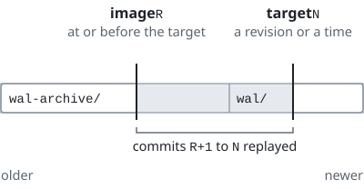

# Backups

NRESE backs up in three ways. No setting schedules them, so take them from your own scheduler,
and prove now and then that they restore, with the [drill](#a-complete-drill) below. The offline
commands run in a container the way an offline load does
([loading data](server-setup.md#loading-data)).

| | Holds | Taken | Restored |
|---|---|---|---|
| [An image](#image-backups) | One repository's statements as stored, inferred ones included, with a manifest. Not its settings, namespaces or quarantine, nor the users and other repositories | While the server runs (`POST …/image`), or offline (`nrese-server backup`) | Offline, with `nrese-server restore`, by an NRESE that reads its checkpoint format |
| [An N-Quads export](#n-quads-exports) | The asserted statements, closed by their checksum | While the server runs (`GET …/backup`) | Over HTTP (`POST …/restore`), or offline with `nrese-server load --replace`. Any RDF store reads it |
| A copy of the data directory | Everything | While the server is stopped | Copy it back, with the server stopped |

An image restores without parsing, and with the archived log it restores to
[any later revision](#point-in-time-restore); with reasoning on, the first start after it
derives the inferences again. An export outlives versions and stores. For a whole server, with
its users and every repository, copy the data directory.

## Image backups

`POST /api/v1/repositories/{id}/image` (administrators) writes an image of the repository's
current snapshot while writes go on. It goes into `backups/` of the repository's directory, named
by the seconds since 1970: `backups/1794787200/` of the data directory for the default
repository, `repositories/films/backups/films-1794787200/` for the repository `films`, which
`DELETE /repositories/films` removes with it. Beside the store's checkpoint file is
`manifest.json`, with the revision, the statement counts, the size and the SHA-256. The older
`POST /ops/api/admin/dataset/image` still answers; with `?repository=ID` its image goes into
`backups/<id>-<seconds>/` of the data directory. An image in `backups/` is on the same disk as
the data it protects, so copy it elsewhere.

Offline, with `store.mode = "on-disk"`, `nrese-server backup DIR` writes the default
repository's image into `DIR`.

To restore, stop the server and run `nrese-server restore DIR` with the target's configuration.
It checks the image against its manifest and places it in the data directory, which must hold no
store. The server then opens at the image's revision.

## N-Quads exports

`GET /api/v1/repositories/{id}/backup` streams every asserted statement as
[N-Quads](https://www.w3.org/TR/n-quads/), named graphs kept, and closes it with its SHA-256 as
the comment `# nrese-sha256 <hex>`, which N-Quads readers skip. Its headers carry the source
revision and the statement count ([HTTP interface](http-api.md#engine-api-apiv1)).

`POST /api/v1/repositories/{id}/restore` replaces the repository's statements with the export's,
as one commit, and derives the inferences again. It checks the checksum first and answers `400`,
changing nothing, when it doesn't match. Like any write, it passes the target's checks, so a
target that reasons or validates may refuse it with `400`, changing nothing. Over HTTP an export of at most about 384 MiB restores
(3 × `budgets.upload_size` + 64 KiB, held whole while it is parsed). A larger one restores offline
with `nrese-server load --replace export.nq`, which doesn't check the checksum, so check it
first, as in the drill's first step.

The older `/ops/api/admin/dataset/backup` and `/restore` still answer.

## Point-in-time restore

With [`store.wal_archive`](config-reference.md#store.wal_archive) on, checkpoints move the log segments they
cover into `wal-archive/` of the data directory instead of deleting them. An image and the log
after it then restore the store to a later revision, if the log holds every commit between
them. A bulk load or a rematerialisation writes a checkpoint, not a log record, so take a new
image after one:

<picture>
  <source media="(prefers-color-scheme: dark)" srcset="../img/restore-dark.svg">
  
</picture>

```bash
nrese-server restore DIR --wal DATA/wal-archive --wal DATA/wal --until-revision N
nrese-server restore DIR --wal DATA/wal-archive --wal DATA/wal --until-time 2026-10-02T14:05:00Z
```

- `--until-revision N` replays the commits up to revision `N`, and fails if the log ends
  before it. Every commit is one revision; `GET /api/v1/repositories/{id}/info` gives the
  current one to whole-dataset readers and administrators.
- `--until-time T` replays the commits made up to `T`, an RFC 3339 time with a zone, read by the
  `xsd:dateTime` calendar: no leap second `:60`, offsets within ±14:00, `24:00:00` the next day's
  midnight, and digits past the microsecond cut off. It doesn't check that the log reaches
  `T`: the `restored` log line names the revision reached, so compare it with the one you expect.
- With both, it stops at `N`, and fails if a commit after `T` comes before `N`.
- Without either, it replays as far as the log goes.

A restore by time refuses an image whose last commit was made after `T` (take an older image),
and an image with no commit time (restore it by revision). These have none:

- images written before 7 November 2026 (checkpoint format 11);
- every image, a bulk replacement's included, of a store upgraded from such a checkpoint, or
  created before 2 October 2026;
- images of a replica of one of these.

To get restore by time for such a store, export it as N-Quads and `nrese-server load` the export
into a new, empty data directory. That store's images have commit times.

The target data directory must hold no store. After a failed restore, try again into a fresh,
empty directory: a refusal can come before the image is placed, with the directory as it was.

`nrese-server prune-archive R` removes the archived segments whose records all come before
revision `R`, so after an image at revision `R - 1` or later. It is safe while the server runs.

## Recovering a server

From an image (`backups/<seconds>/` of the data directory, or a copy elsewhere):

1. Stop the writers.
2. Restore the newest image into an empty staging directory:
   `NRESE_DATA_DIR=/srv/nrese-staging nrese-server restore /srv/nrese-data/backups/<seconds>`,
   with `--wal` to replay the log after it. Exit `0` means the image passed its manifest check
   and is in place.
3. Start a server on it with writes off, on another port:
   `NRESE_STORE_MODE=on-disk NRESE_DATA_DIR=/srv/nrese-staging NRESE_DEPLOYMENT_POSTURE=read-only-demo NRESE_BIND_ADDR=127.0.0.1:8081 nrese-server`.
4. Check that `/readyz` answers `200`, that `GET /api/v1/repositories/{id}/info` gives the
   `revision` and `quad_count` you expect, and that a few known queries answer as before. To
   compare two servers in full, run the drill's third step against both.
5. To promote it, stop the staging server, start the production server with `NRESE_DATA_DIR` on
   the restored directory, check `/readyz` again and switch the traffic. The image brings the
   default repository's statements only: users, other repositories, stored settings and
   namespaces come back from a copy of the data directory, or are set up again.

## A complete drill

A drill proves that a backup restores. This one is small enough to run against the
[quick start](../../README.md#quick-start)'s server on port 8080. It restores that server's
export into a second, empty server on port 8081 and compares the two. The commands are for Linux
(GNU `head`).

```bash
# 1. Back up: an N-Quads export of every asserted statement, closed by its checksum.
curl -sS -D backup-headers.txt -o export.nq http://localhost:8080/api/v1/repositories/nrese/backup
grep -i '^x-nrese' backup-headers.txt   # its source revision and quad count
tail -n 1 export.nq                     # "# nrese-sha256 <hex>"
head -n -1 export.nq | sha256sum        # the same <hex>

# 2. Restore it into a fresh server.
docker run -d --name nrese-drill -p 127.0.0.1:8081:8080 -v nrese-drill:/var/lib/nrese/data \
  -e NRESE_REASONING_MODE=owl2-rl nrese
until curl -sf http://localhost:8081/readyz; do sleep 1; done
curl -sS -X POST -H 'Content-Type: application/n-quads' --data-binary @export.nq \
  http://localhost:8081/api/v1/repositories/nrese/restore

# 3. Count the asserted statements of every graph on both.
q='query=SELECT (COUNT(*) AS ?n) WHERE { { ?s ?p ?o } UNION { GRAPH ?g { ?s ?p ?o } } }'
curl -sS --data-urlencode infer=false --data-urlencode "$q" http://localhost:8080/dataset/query
curl -sS --data-urlencode infer=false --data-urlencode "$q" http://localhost:8081/dataset/query

# 4. Remove the drill's server.
docker rm -f nrese-drill && docker volume rm nrese-drill
```

The drill passes when:

- the two checksums of step 1 are the same;
- the restore answers `200` with `"checksum_verified":true` and a `quad_count` equal to
  the backup's `x-nrese-quad-count`;
- both counts of step 3 are that number too.

## Scenarios to repeat

| Scenario | Steps | Passes when |
|---|---|---|
| Standard restore | The drill, from the latest backup, into a clean data directory. A store-sized backup restores offline, as above | Step 3's counts match the backup's quad count, and your own check queries return their recorded answers |
| Interrupted write | Stop the server hard (`docker kill nrese`) while updates run, then start it on the same data directory | It becomes ready, and every acknowledged commit is there. Opening replays the log's intact records and cuts a torn last one. Other damage stops the start unless `store.wal_damage` says otherwise ([durability](../spec/02-storage-and-transactions.md#durability-on-disk-mode)) |
| Rollback | Restore the backup taken before a change, then run the queries your clients depend on | They return the answers recorded before the change |

From each run, keep the backup's source revision, quad count and checksum, the restore's answer,
the start and end times, and the counts and answers you compared.
