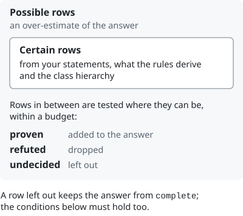

# Reasoning: supported semantics

This is the contract for what NRESE's reasoning computes, for the code of the commit this page is in (`SEMANTICS_VERSION` 4 since 7 November 2026: the datatype checks read literals as OWL 2's datatype map does, so a consistency verdict version 3 recorded is rechecked once; 3 since 28 October 2026: closures version 2's maintenance wrote are rebuilt once). A mode name alone doesn't state it; this page does. The source of truth is `crates/nrese-reasoner/src/rulesets.rs` (the rule text) and `lists.rs` (list axioms).

The standards behind the modes are [RDF 1.1 Semantics](https://www.w3.org/TR/rdf11-mt/) (RDFS
entailment), the [OWL 2 Profiles](https://www.w3.org/TR/owl2-profiles/) (OWL 2 QL, and OWL 2 RL
with its RDF rules), the [OWL 2 Direct Semantics](https://www.w3.org/TR/owl2-direct-semantics/) and
[RDF-Based Semantics](https://www.w3.org/TR/owl2-rdf-based-semantics/), and, for what a query
answers under them, [SPARQL 1.1 Entailment Regimes](https://www.w3.org/TR/sparql11-entailment/).

## Modes

`reasoner.mode` / `NRESE_REASONING_MODE`: `disabled`, `rdfs`, `rdfs-full`, `rdfs-plus`, `owl-horst`, `owl2-ql`, `owl2-rl`, `owl2-dl` or `custom`. The profiles between `rdfs` and `owl2-rl` are the RDFS rules plus named OWL 2 RL rules, as GraphDB's rulesets of the same names are. User rules in Notation3 (`reasoner.rules`) are added to any of them, or are the whole program with `custom` (see "User rules" below).

| Mode | Rules |
|---|---|
| `rdfs` | the 6-rule subset below |
| `rdfs-full` | rdfD2, rdfs2 to rdfs13 (rdfs4a/b included) and 50 axiomatic triples: the RDF and RDFS axioms without the infinitely many about `rdf:_1`, `rdf:_2`, …, and rdfs1 for `rdf:langString`, `rdf:HTML`, `rdf:XMLLiteral` and `xsd:string`. rdfD1 (a blank node per literal) is left out, so no blank node stands for a literal: test a value's type with `FILTER(datatype(?v) = xsd:integer)`. The `rdf:_1`, `rdf:_2`, … axioms are absent: assert those a query needs. Otherwise none known. Axioms seed every closure and no deletion retracts them |
| `rdfs-plus` | `rdfs` + eq-sym, eq-trans, eq-rep-s/p/o, prp-fp, prp-ifp, prp-symp, prp-trp, prp-eqp1/2, prp-inv1/2, cax-eqc1/2, scm-eqc1/2, scm-eqp1/2 |
| `owl-horst` | `rdfs-plus` + cls-hv1/2, cls-svf1/2, cls-avf |
| `owl2-ql` | prp-dom, prp-rng, prp-spo1, prp-eqp1/2, prp-inv1/2, prp-symp, cax-sco, cax-eqc1/2, cls-svf2, the schema rules scm-cls, sco, eqc1/2, op, dp, spo, eqp1/2, dom1/2, rng1/2, and the checks prp-asyp, prp-irp, prp-pdw, cls-nothing2, cax-dw. Existentials on the right of `SubClassOf` are not materialised (they would invent individuals); queries get the answers through them by tree-witness rewriting (`reasoner.ql_rewriting = "auto"`, the default; [design](../design/ql-rewriting.md)), each answer saying whether it is complete |
| `owl2-rl` | below. Its standard semantics: the OWL 2 RL/RDF rules' closure, no answers through existentials on the right, with every answer `sound-only` (the closure's). A repository may add the QL rewriting (`ql_rewriting = "on"`, per repository or `reasoner.ql_rewriting`); `owl2-dl` mode gets those answers through its bounds |
| `owl2-dl` | the `owl2-rl` rules as the lower bound, and the OWL 2 DL engines: below |

### Unnamed union classes

With `reasoner.unnamed_classes = "skip"`, an unnamed class that has an `owl:unionOf` and occurs only as the object of `rdfs:domain`, `rdfs:range`, `rdf:type`, `rdfs:subClassOf` or `owl:allValuesFrom`, or in its own definition, gets no inferred members: no rule consumes them and no query can name the class. A membership of such a class declared `owl:Class` becomes an `owl:Thing` membership where the ruleset has scm-cls. The closure is otherwise the full one (property test over every ruleset).

### `rdfs`: a 6-rule RDFS subset

| Rule | Derives |
|---|---|
| rdfs2, rdfs3 | domain and range typing |
| rdfs5, rdfs11 | transitive `subPropertyOf`, `subClassOf` |
| rdfs7, rdfs9 | subproperty and subclass propagation |

The subset leaves out:
- the remaining RDFS entailment rules (rdfs1, rdfs4a/b, rdfs6, rdfs8, rdfs10, rdfs12, rdfs13 and the `rdf:` rules);
- axiomatic triples.

This matches GraphDB's `rdfs` with *partialRDFS*. Full RDFS entailment is `rdfs-full`.

### `owl2-rl`: OWL 2 RL/RDF rules

#### Included

- 58 fixed rules from W3C OWL 2 Profiles §4.3 tables 4 (equality), 5 (properties), 6 (classes), 7 (class axioms) and 9 (schema vocabulary), with the W3C rule names.
- One extra `eq-diff1`, by which `x owl:differentFrom x` is inconsistent (see `eq-ref` below).
- List axioms, instantiated per axiom: `prp-spo2` (property chains), `prp-key`, `cls-int1/2`, `cls-uni`, `cls-oo`, `scm-int`, `scm-uni`, `cax-adc`, `eq-diff2/3`, `prp-adp`.
- The cardinality rules (`cls-maxc1/2`, `cls-maxqc1-4`) read a cardinality only as the RDF mapping writes it, `"0"^^xsd:nonNegativeInteger` or `"1"^^xsd:nonNegativeInteger`; any other spelling, such as Turtle's plain `1` (an `xsd:integer`) or `"01"^^xsd:nonNegativeInteger`, isn't read, so the QL rewriting's status over such a schema is never `complete`.

#### Omitted, and what that means

| Omitted | Consequence |
|---|---|
| `eq-ref` (`x sameAs x` for every term) | Not materialised (it would double the store). Its consistency consequences are kept: `x differentFrom x`, and AllDifferent lists naming one individual twice, are inconsistent. Queries for `?x owl:sameAs ?x` don't return one for every term; a reflexive statement that is asserted is returned like any other. |
| Datatype rules, table 8, in part | `dt-not-type` and `dt-diff` are checked: a value outside a property's range datatype (a string where the range is `xsd:integer`, an integer where it is `xsd:double`, whose value spaces are disjoint in OWL 2, 300 for `xsd:byte`) and two different data values made the same (a functional data property with two values) are inconsistencies, on materialisation and on commits. Values are those of OWL 2's datatype map, read as the `owl2-dl` route reads them: every integer, whatever its size; `xsd:hexBinary` and `xsd:base64Binary` (disjoint); `rdf:PlainLiteral`; one instant at two timezone offsets is two values (OWL 2 Structural Specification §4.7). An ill-typed literal (a datatype of the map with a lexical form outside it, such as `"abc"^^xsd:integer`, `" 42"^^xsd:integer`, `"+F"^^xsd:hexBinary`, a `xsd:dateTimeStamp` without a timezone, or an `rdf:XMLLiteral` that isn't well-balanced, self-contained XML content; the whole lexical form is checked before a value is found beyond what is represented) has no value, so under a range it is an inconsistency (RDF 1.2 Concepts §3.4): such a commit is rejected under `owl2-rl`. `dt-type1` is done: each of the 32 datatypes OWL 2 RL supports (all of OWL 2's but `owl:real` and `owl:rational`) is an `rdfs:Datatype`, as inferred statements that seed the closure and are never retracted, so an empty store holds them too. Not done: `dt-type2` and `dt-eq` (literals aren't typed or equated by value, so `"1"^^xsd:integer` and `"01"^^xsd:integer` stay two terms in answers, though the checks treat them as one value). So nothing that promises more than the closure relies on the rule set where an axiom's rules would compare or type data values (a key on a data property, a negative data property assertion, disjoint data properties, a data `hasValue` or `someValuesFrom`, a qualified data maximum with `owl:onDataRange`): under `owl2-dl` such an ontology leaves the RL route and the DL path decides it by value, and under `owl2-rl` the QL rewriting's status for it is never `complete`. The rewriting reads the schema without the assertions, so under `owl2-rl` it also counts a key or a property disjointness on a property not declared an `owl:ObjectProperty` as one on data values: such an answer can be `sound-only` where it is in fact complete. A cardinality spelled otherwise than the RDF mapping writes it isn't read by the rules either (see "Included"), so under `owl2-dl` such an ontology leaves the RL route too, and the DL path reads it by value. Also not judged: an ill-typed literal no range or class types isn't judged, nor a datatype outside the map (`xsd:date`, `xsd:gYear`) or a value beyond what is represented (a number past 128 bits, a year past 10¹¹, more than 18 fractional digits of a second, an `rdf:XMLLiteral` with comments or processing instructions). |
| Axiomatic triples | Not materialised (as W3C allows for the RL/RDF rules), but for `dt-type1`'s datatype statements (above). Assert those a query needs; they are then stored and returned like any statement. |

#### List limits

- Lists of any length are instantiated. `owl:AllDifferent`, `owl:AllDisjointClasses` and `owl:AllDisjointProperties` over more than 100 members become one rule each whose pairs are checked through an index of the members (a rule per pair would be quadratic); shorter ones a rule per pair. The cost differs by kind: the long `owl:AllDifferent` rule starts from `owl:sameAs` statements and the long `owl:AllDisjointClasses` rule from an individual's types, but the long `owl:AllDisjointProperties` rule (`prp-adp`) joins every statement with every other statement of the same subject and object, whatever the properties: on a large store, a full materialisation with such an axiom is markedly slower (commits only check their new statements). Disjoint property sets of over 100 members are rare; split into axioms of at most 100, they are a rule per pair again.
- A property chain with more than 250 properties, a key with more than 127, or an intersection of more than 256 classes can't be one rule (the rule format numbers a rule's variables and atoms by a byte, and a key's rule has two atoms per property) and isn't instantiated (`list-too-long`). Under `owl2-dl`, an OWL 2 RL ontology with a list axiom the rules leave out (these, a list with more than 64 member sequences, or one that returns to its head through `owl:sameAs`) leaves the RL route, and the DL path decides it.
- A list axiom is instantiated for at most 64 member sequences (when `sameAs` makes several nodes one list).
- Those, malformed (a node without `rdf:first`/`rdf:rest`) and cyclic lists are not instantiated, never truncated. Each one is reported as a typed diagnostic (`malformed-list`, `cyclic-list`, `list-too-long`, `too-many-list-variants`) with the axiom and node decoded:
  - full materialisations (load, startup) report all of them: in the log, and under `last_materialisation` in `/ops/api/diagnostics/reasoning`;
  - a commit reports those it introduced: in the log, and under `last_run`.
- While a list axiom is left out, an answer that reads the inferences isn't `complete`: with the QL rewriting it says `sound-only`, with the reason, also inside a transaction and for a reader of some graphs (one with `inferred = "visible"` gets `not-certified`); without the rewriting every answer is `sound-only` anyway.

#### Generalised triples

- Full materialisation may derive intermediate triples RDF can't store: a literal subject, or a non-IRI predicate.
- Only storable facts are persisted. Commit-path reasoning reads persisted facts, so it doesn't see the dropped ones.
- This only affects rules that would turn such triples back into storable facts, for example `owl:inverseOf` on a datatype property, which OWL 2 doesn't allow. What to do: none known beyond keeping such axioms out of the ontology.

#### Completeness

W3C states the conditions under which the RL/RDF rules are complete for OWL 2 RL ontologies. Datasets labelled EL, QL or DL are reasoned with these RL rules, and results are RL entailments, not EL/QL/DL reasoning: an answer over a ruleset's closure where the QL rewriting doesn't run carries the status `sound-only` (the `nrese-completeness` header; `unsound` under [the operators below](#what-may-be-complete)) with the ruleset's regime, saying it is the closure's: the rules are complete for the ontologies of their profile, which isn't checked per query. Where the rewriting runs (by default under `owl2-ql`; under `owl2-rl` with `ql_rewriting = "on"`), each query is checked, and its answers may be `complete` (below). `owl2-dl` gives certain answers under OWL 2 DL.

#### What `complete` refers to

Every status that rests on reasoning names its regime (an asserted-only `complete` and `not-certified` name none: [HTTP interface](../ops/http-api.md#requests-in-detail)) (`regime=` in the header, `regime` in EXPLAIN; `nrese_sparql::Regime`, set by whoever produces the status): `owl2-ql`, `owl2-rl`, `owl2-dl`, `rdfs` or `custom`. Under `owl2-ql`, `owl2-rl` and `owl2-dl` alike, `complete` means that no certain answer under the OWL 2 Direct Semantics is missing. Under `owl2-ql` and `owl2-rl` it is given only where the QL rewriting ran on the query, and only when no axiom of the schema could add an answer the query reads that the closure and the rewriting miss: an axiom outside the closure's profile, or one that meets an individual an existential implies ([design](../design/ql-rewriting.md) §7). Nor is it given where the query reads anything but [what may be complete](#what-may-be-complete). Generated ontologies check it against a DL reasoner's certain answers (`generated_cases_answer_as_the_dl_oracle`). Under `rdfs` and `custom`, no answer is `complete`.

One rule holds under `owl2-ql`, `owl2-rl` and `owl2-dl`, on every path: a ruleset's closure, the QL rewriting and the DL bounds.

- **What may be `complete`:** a query whose every read is a predicate of your own, or `rdf:type` with a named class of your own. Your own means outside the rdf:, rdfs: and owl: namespaces. Under `owl2-dl` one more read may be: `owl:sameAs` between two different IRIs that the upper bound U1 has as individuals. On the RL route no U1 is built, so there it may not.
- **Every other read is `sound-only` at best:** a predicate or class of those namespaces, a variable predicate or class, and `DESCRIBE`. OWL 2 entails statements of that vocabulary that no closure, rewriting or bound holds in full: a term `owl:sameAs` itself, `rdf:type owl:Thing`, the top properties, a class's subsumption of itself. The rule doesn't list them; it lets through only what is known to be held. So some right answers are marked lower: `ASK { :Dog rdfs:subClassOf :Animal }` isn't `complete`.
- **Values matched by spelling:** a query that matches a typed literal against the data is `sound-only` at best. That is a literal other than a string (plain or with a language tag) in a pattern, or a variable in a pattern that `VALUES` binds to one, or that a `BIND` or a projection binds to a computed value, a copy or a typed constant. A number or date has several spellings (`"2"`, `"+2"` and `"02"` are one `xsd:integer`), and OWL 2 entails a row by the value, but the store matches the value as written, the stored values as they were written too. A value only compared in a `FILTER` (`?v = 2`), which SPARQL does by value, or only projected, leaves the answer as it is.
- **Values compared by spelling:** the store also compares the values it reads as written, where a query joins on a variable (one variable at two places), returns it under `DISTINCT`, groups by it or counts it with `COUNT(DISTINCT …)`, steps back along a path (`^p`), or ends a path that may take no step (`p*`, `p?`). Where a property it reads there holds a number or a date (any literal but a plain or language-tagged string; for a path that may take no step, any property, since zero steps pair every term with itself), the answer is `sound-only` at best: `"7"` and `"07"` as `xsd:integer`, or `7` and `7.0`, are two terms to the store and one value to OWL 2, so a join can miss a row and `DISTINCT` can return one value twice. Under an aggregate the count can then be wrong, and the answer is `unsound` ([operators](#what-may-be-complete), below). What each property holds is read from the data at each run.
- **RDF 1.2 terms:** OWL 2 doesn't define triple terms or base-direction literals (`"…"@en--rtl`). A query that uses one is never `complete`, and neither is a query whose reader's readable graphs hold a triple term (for a reader of every graph: the store holds one).
- **Marked lower on purpose:** a reader of only some graphs is marked wherever the query compares values as above, whatever the properties hold, so the status says nothing about graphs they can't read; a `DISTINCT` with no projection right under it counts every end of its pattern as returned; and a variable in two branches of a `UNION` counts as a join. Each may mark an answer that misses nothing.
- **Operators:** where answers may be missing, `OPTIONAL`, `MINUS`, `EXISTS`, `LATERAL`, an aggregate, and `LIMIT` or `OFFSET` after `ORDER BY` make them `unsound`: a missing row can make a returned one wrong. `LIMIT` or `OFFSET` without `ORDER BY`, `GRAPH`, `SERVICE` and `DESCRIBE` leave them `sound-only`: every row they return is one of the answer's rows.

A plan's status never claims more than the run's; it may claim less where the run decides, and its reason then says so.

### `owl2-dl`: OWL 2 DL, answers with their completeness

The OWL 2 Direct Semantics over the asserted statements of every graph, read as an OWL 2 ontology by the reverse RDF mapping ([design](../design/owl2-dl.md) §8). Every answer is sound unless it says `unsound`: a read inside a transaction whose pending operations delete statements, a query whose answers may be missing under an operator [that can make a missing row a wrong one](#what-may-be-complete) (item 4 below), or an ontology over which L may hold what OWL 2 DL doesn't entail (the first item below). Every answer also says whether it is complete (`complete`, `sound-only` or `unsound`, with the reasons and the bounds' counts, in the `NRESE-Completeness` header and EXPLAIN: the status QL's rewriting reports too, `nrese_sparql::Completeness`); certain answers to conjunctive queries over OWL 2 DL have no known decision procedure, so the store answers through bounds and says what it knows. The picture shows how a query the bounds answer (items 2 and 3 below) gets its rows.

<picture>
  <source media="(prefers-color-scheme: dark)" srcset="../img/dl-answers-dark.svg">
  
</picture>

- The lower bound L is the `owl2-rl` closure (the inferred stack, maintained per commit as under `owl2-rl`), plus the class memberships the DL engines' taxonomy of the TBox adds (every member of `C` is a member of each superclass of `C`; the taxonomy is the TBox's alone, so its subsumptions hold whatever the assertions). L's facts are entailed where theorem PR1 of OWL 2 Profiles holds for the ontology: it has no annotation-property axioms (a domain, range or super-property of an annotation property, or another kind of property made its sub-property; the nine annotation properties OWL 2 builds in, `rdfs:label` and `rdfs:comment` among them, count without a declaration) and no punning (one IRI used as a class or property and as an individual). OWL 2 DL gives annotation-property axioms no meaning for the terms annotated, while the rules use them; and it reads `owl:sameAs` between punned names as equating the individuals only, while the rules equate the classes or properties of those names too. So every answer is `unsound`, its reason naming one such property, where the ontology has annotation-property axioms; and every answer is `unsound`, its reason naming the name, where a punned name is `owl:sameAs` another term in L. Punning without such an equality keeps its status. Both are read off the revision's whole ontology, not the query; where that read is refused at its budget, every answer is `unsound`, saying the reading isn't known. Where the reader left out an axiom whose statements the rules may still read (the reserved vocabulary used as an entity, OWL's vocabulary outside the mapping's forms, a structure or list the mapping doesn't read, or syntax not read yet), every answer is `unsound`, its reason naming the first such part, and the data's consistency is `unknown`, not consistent: OWL 2 DL says nothing of what was left out. A read inside a transaction is told what the reader left out of the revision it began on, so an addition it would leave out may be told `sound-only` until it is committed. The ways out: remove such axioms, give the individual its own IRI, or use `owl2-rl`, whose promise is the rules' reading.
- The upper bound U1 is PAGOdA's datalog strengthening of the ontology (Zhou et al., JAIR 2015, Definition 5.1): disjunctions split so that every disjunct is derived (choosing one would lose an answer the other gives where `⊥` blocks the first), existentials c-Skolemised to constants, `⊥` turned into a clash fact, evaluated over L and the data. For a consistent ontology it contains every certain answer of a conjunctive query (Theorem 5.5 (ii)); answers are therefore claimed complete only where consistency is proven. Maintained per commit by the delta executor beside the engine's stacks, never visible as data; U1's own terms (Skolem constants) are never answers. Keys are rules of U1 (over every term: more equalities, still an upper bound). A key applies to the individuals the ontology names: an individual named only in a query isn't made a named individual of the ontology by being asked about, as HermiT and Openllet answer and as realisation does. By the letter of the Direct Semantics (§2.2, §4) such an individual would count as named, and a key could then make it a member of a class and equal to an individual of the ontology; this store doesn't answer by that reading. So where the ontology has keys, or wasn't read within its budget, a query that names as a subject or object an IRI the data holds nowhere is `sound-only` at best, its reason naming the IRI. U1 compares data values by value, OWL 2's identity of data values (`nrese_xsd::owl::Value`): a key, a `hasValue` and a join over data values match `"07"` and `"7"` as `xsd:integer`, or `7` as `xsd:integer` and `7.0` as `xsd:decimal`; each literal is read as the first literal of its value U1 met. U1's `owl:sameAs` classes are kept by one representative each (ADR-0011's monotone backend: the reasoner's equality by representatives), never as the pairs of a class, and queries read U1 expanded to every identity; a U1 with classes, or one a commit's equality would give classes, is evaluated afresh on the commit.
- Consistency is checked on commit: a commit that makes consistent data inconsistent under OWL 2 DL is rejected (`owl2-dl-consistency`), decided by U1 where it proves consistency (no clash, every `⊥` checked, and the value of every literal a key or a negative assertion compares read: one it can't read, such as an `xsd:date` written two ways, would be a join it misses; once it met one, U1 proves no consistency until it is built again, at a restart, a rebuild of the inferences or a commit that rebuilds it), else by the context core (Horn ontologies) or the hypertableau. Where the hypertableau gives up on the whole ABox within its budget, it decides it island by island (`nrese_dl::islands`, after Wandelt and Möller; batches of at most a quarter of the node budget): a role assertion whose role no clause reads across (no universal, `∃R.C ⊑ D`, at-most, functional, chain, transitivity through it, disjoint or asymmetric role, for the role or a super-role) is replaced by `∃R.⊤` at its subject and `∃R⁻.⊤` at its object, and the rest joins individuals (with `sameAs`, `differentFrom`, negative assertions, and keys by value); the ABox is decided whole with a nominal in a clause's head or the universal property. The verdict is the whole ABox's (checked on 3,000 random ontologies). Data inconsistent before a commit is quarantined, not locked. Where the OWL 2 RL rules find a clash in an ontology with annotation-property axioms or a punned name, which OWL 2 DL may read as consistent, this release doesn't decide it: the commit is refused, its reason saying so, and data that holds such a clash (by a bulk load, say) is `undecided`, not `inconsistent`, and quarantined alike, with the reason (`consistency_reason`). It is derived when the store opens and after a rebuild that finds violations, never stored; a check that doesn't finish within its budget leaves it `undecided` too, saying so. A clash in an ontology with neither stays `inconsistent`. An undecided check accepts the commit and leaves the status `unknown` (then no answer is complete). `dl.consistency = "off"` doesn't check.
- For queries (everything reading the inferred statements):
  1. a query whose predicates and classes have no fact in U1 beyond L is answered over L, complete, whatever its operators (where U1 covers every axiom);
     a monotone query whose predicates and classes with facts in U1 beyond L have only facts with a Skolem constant there, and which puts a term or an answer variable (not one an expression computes from) at both ends of each such pattern, is answered over L too, complete (path `skolem-only-gap`): an answer U1 adds would name a Skolem constant, never an answer. An existential variable, a path or an `ASK` meeting such a pattern goes to the bounds (LUBM's existentials take this path: all 14 queries in one evaluation);
  2. otherwise a monotone query (basic graph patterns, paths, joins, unions, filters, projection, `DISTINCT`, `ORDER BY`, `BIND`, `VALUES`) runs over L and over L ∪ U1; equal answers are complete;
  3. the gap's candidates, for one basic graph pattern under filters over its answer variables, go to the exact services: each ground atom not in L by the DL engines (`ExactGroundEntailment`: its negation makes the ontology inconsistent), each tree of existential variables rolled up into a class expression with named terms as nominals (`ExactInternalisableCQ`). A candidate that a representative Skolem constant alone witnesses is never taken as an answer: it is proved as above, refuted, or left unresolved (a cycle through existential variables can't be rolled up). At most `dl.max_candidates` candidates within `dl.timeout`;
  4. `sound-only` with the reason: unresolved candidates; `CONSTRUCT` (answered over L); a read [the rule](#what-may-be-complete) leaves `sound-only` (the schema vocabulary: entailed schema statements aren't bounded, `/classification` has them; reflexive `owl:sameAs` is in neither bound); a reader who sees part of the data; a query naming its dataset; U1 not available; consistency not proven; a read whose revision's bounds a later commit replaced while it was read (answered over L); user rules (below); a read every name may answer (below). A query whose answers aren't complete, for any of these reasons or because its predicates' bounds differ, is `unsound` instead under the operators [the rule](#what-may-be-complete) names: a missing row can keep a row the certain answers lack. Under `LIMIT` or `OFFSET` without `ORDER BY`, `GRAPH`, `SERVICE` and `DESCRIBE` it stays `sound-only`.
     A read inside a transaction reads the latest revision: with nothing pending, exactly as a query outside it (through that revision's bounds); with operations pending, which aren't reasoned over before the commit, the committed closure with them, `sound-only` (additions only) or `unsound` (deletions: their inferences remain until the commit).
     A variable in an individual's place ranges over every name of the ontology, a class's or property's name too (SPARQL 1.1 Entailment Regimes §7.2, (C2): a name that occurs in the ontology), and the store answers for the individuals it reasons about. Where the class or property a read asks about may hold of every element, every name may be an answer, so the read is `sound-only`, its reason naming the class or property. That is where U1 holds it of its element standing for every element and the exact services, within the read's own deadline and memory, don't refute the query for that element, a name in no axiom: with no unique-name assumption such a name may denote any element, so it answers the query exactly where every element does. Proved, the reason says every name is an answer; not decided, that every name may be one. A query with two answer variables or more is `sound-only` on U1's word alone. So is one whose answer variable stands beside a name the data doesn't use as an individual, as in `SELECT ?y { :Cat :p ?y }` where U1 holds `:p` of its element: there the missing rows may bind `?y` to individuals too, which one row for the element doesn't ask about. The same holds where the name reaches the answer through a path's end (`:Cat :p+ ?y`), an alias (`SELECT (?s AS ?y)`, `BIND`) or a filter on a variable a `SELECT` doesn't return. A path read is `sound-only` wherever U1 holds one of its steps' properties of its element, even where the path's ends are individuals: that demotes more reads than must be. Under a filter the exact services decide the pattern alone, which they can refute but not prove, so a proof there says only that every name may be an answer. An `ASK` about a name the data doesn't use as an individual, such as `ASK { :Cat a :Animal }` where `owl:Thing` is a subclass of `:Animal`, is then `false` and `sound-only`: the store found no answer, which doesn't mean none holds. A variable the query doesn't return is read as in a conjunctive query, existentially: a row is returned where the data entails a successor that has no name. Here the store departs from the regime, which binds every variable of the pattern, returned or not, to a name of the ontology (§7.2, (C2)): it may return a row the regime doesn't ([limits](../limits.md#reasoning)).
  5. `dl.answers` (and `dl-answers` per query): `certain-where-complete` (the default), `sound` (L alone), `exact` (a 422 error when not complete: [HTTP interface](../ops/http-api.md#queries)). A read of the inferred statements alone, and one inside a transaction with operations pending, isn't certified complete, so `exact` always refuses it before it runs, and the reasons say which.
- U1 is kept for one revision at a time and never serves another: a query reads U1 and the snapshot of one revision under one lock (U1 maintained by the commits, or built afresh for a revision it doesn't describe), and its answers are evaluated on the snapshot its status was decided on, never a later one. A transaction reads the latest revision; a replica builds U1 from the records at its revision; a restart builds it afresh from the data. Tested while commits run (alternating closed and open predicates, three readers), inside transactions, on replicas and across a restart.
- Work is routed by profile: each axiom's OWL 2 profiles (EL, QL, RL) are read off the Profiles grammars (`nrese_owl::profile`; it agrees with the W3C test cases' annotations on 277 of 297 cases, the other 20 annotations contradicting the Recommendation's text or covering unread imports, listed with why). An ontology entirely in OWL 2 RL, with no punning and no annotation-property axioms, is decided by the RL rules alone, which are complete for it (theorem PR1, whose conditions those are): no U1 is compiled or maintained, the RL gate decides each commit's consistency (engine `rules`) where the rules assessed the commit's base and found it clean (a rebuild, or gated commits since), and every query that reads only [what may be complete](#what-may-be-complete) is complete over L. OWL 2 RL's datatypes are the OWL 2 datatype map's but `owl:real` and `owl:rational`, so a literal of another datatype of the standard vocabularies (`xsd:date`, `xsd:gYear`, `xsd:duration`) is outside OWL 2 RL, its data too; a datatype the ontology names itself stays on the route, its literals kept as written, never compared by value or typed by a range. Off the route, where such a literal's value or form can decide a clash (under a range, a functional property or a cardinality, or compared), the full check has no value for it: the consistency is `unknown` and no read is `complete`. One nothing reads changes nothing. Horn and EL ontologies go to the context core (consistency, classification, the exact services' tests), the rest to the hypertableau. A schema change re-reads the route, and so does an assertion that gives a term a kind the last reading didn't: a class or property name used as an individual, an `rdf:type` with a class not yet read, a property's first use, or a literal value of a property not read as a data property (an undeclared property used only with literals is a data property), or a literal of a datatype outside OWL 2 RL's; and so does a deletion of a literal value of a property not declared a data property, which may be its last. Any other assertion keeps the route, and so does a statement of an annotation property, which gives its terms no kind. An ontology off the route stays off until a commit reads it again, so after a deletion that would bring it back (one that ends a pun, say) the DL path decides it until then.
- Every DL path has a budget: `dl.timeout` for each task (a commit's check, a query's exact services, a classification, U1's evaluation), the deterministic `dl.max_candidates`, `dl.max_nodes` and `dl.max_branch_points` where a path decides an answer, and the context core's join budget. A spent budget never gives a wrong label: a candidate stays unresolved (`sound-only`), U1 becomes unavailable (`sound-only`), a commit's check `unknown`, a classification incomplete.
- Answers that go beyond L (U1, the exact services, the taxonomy's memberships) are given only to readers of every graph. A reader restricted by the access policy gets L as the policy shows it (`inferred = "supported"` or `"visible"`, as under `owl2-rl`), with `sound-only`: nothing is derived for it from graphs it can't read. A rejected commit's explanation shows a committer only the axioms of graphs it may read; the others are counted, not shown. Justifications (`/explain`'s `owl2_dl`), classification and realisation are for readers of every graph.
- Read replicas give their primary's answers with no status: their reasoned reads are `not-certified` (no certificate comes with the records they apply, and a replica makes none, at its start, in a rebuild or on a change of settings), and are refused under `dl.answers = "exact"`; their consistency is `unknown`. They build the bounds from the records and intern no term (their dictionary continues the primary's).
- A statement OWL 2 DL entails beyond the rules is explained by a justification, a minimal set of the ontology's axioms (each with the triples and graph it was read from), found by divide and conquer with the DL engines as the oracle and confirmed by a fresh test (`/explain`, `owl2_dl`); a rejected commit names the minimal set of axioms that have no model together. Its tests are bounded by `dl.explanation_tests` (no limit by default: [configuration](../ops/config-reference.md)) and `dl.timeout`; past them the set is returned unminimised (`minimal: false`), still entailing the statement.
- Classification and realisation (`/classification`, `/realisation`) and axiom entailment (`StoreService::entails_dl`) are done by the DL engines, each saying whether it is complete; these run in every mode.

## User rules with `owl2-dl`

OWL 2 DL with arbitrary rules is undecidable; rules whose variables bind to named individuals only (DL-safe rules) keep it decidable. User rules (`reasoner.rules`) run with `owl2-dl` as they do with `owl2-rl`: over the RL closure, their variables bound to the store's terms (never to the anonymous individuals OWL 2 DL entails), so their conclusions are entailed under the DL-safe reading. But they never see what only OWL 2 DL entails, and U1 doesn't apply them: a conclusion drawn from such a fact is in neither bound. So with user rules, no answer is claimed complete (the reason names them); answers stay sound, and the DL engines' proofs of candidates still hold (more axioms only add entailments).

## Graph scope

- Rules match over the union of all graphs (default and named).
- Inferred statements go to the default graph.
- An inferred statement is suppressed while it is asserted in any graph: the stored inferred stack holds no copy of it.
- A named graph is not a reasoning boundary: there's no per-graph isolation or placement of inferences yet (planned for v2.0: [Named graphs as a reasoning boundary](../STATUS.md#engine-gaps)). Which graphs an inferred statement came from is known: under `inferred = "supported"` a reader sees it when one of its support graph sets is readable ([reasoner-provenance.md](../design/reasoner-provenance.md); the sets are computed in memory per revision, not stored).
- For a reader who may not read every graph (`inferred = "supported"` or `"visible"`), suppression follows what that reader can read, not the physical stack. An assertion in a graph the reader reads suppresses the inferred row: the reader sees the fact as asserted, in that graph. An assertion only in graphs it can't read suppresses nothing: the fact is shown to it as inferred, in the default graph, where it follows without that assertion. Under `"supported"` that means from the graphs the reader reads; under `"visible"` from the other statements. A cycle back through the fact itself is no derivation. So adding or removing an assertion the reader can't see changes none of its answers. As a reader's permissions grow, a fact can move from its inferred rows to the asserted rows of a graph it now reads. A read that includes that graph (a union default graph, `GRAPH`, `FROM`) still has the fact; inferred-only and default-graph-only reads lose the row. This is NRESE's rule, not another store's: GraphDB, for instance, keeps explicit and implicit as independent flags of one statement. With `reasoner.equality = "compact"` this doesn't hold in this version: a `"visible"` reader isn't shown such a statement.

## Reads

- Reads are asserted plus inferred by default (`Materialised`).
- Per request:
  - `infer=false`, or `FROM <http://www.ontotext.com/explicit>`: asserted only;
  - `FROM <http://www.ontotext.com/implicit>`: inferred only.
- Graph Store reads use the default.

## Consistency

- A commit whose closure violates a consistency rule is rejected. The response carries an explanation: the rule, its premises (asserted or inferred) and the likely commit-local trigger. A committer who may not read every graph is shown the premises asserted in graphs it may read; the others (asserted elsewhere, or inferred: a rejected commit's state has no support sets to tell what it could have derived) are counted, not shown, and none of their terms reaches the report.
- Commit-path checking examines what the commit adds, so it relies on a consistent baseline. When a full materialisation finds violations (data imported without reasoning, or a ruleset switched on later), the store is quarantined:
  - `/readyz` answers 503 with only status `quarantined`; `/api/v1/repositories/{id}/info` gives the violation count to whole-dataset readers or administrators;
  - reads work, never `complete`. Under `owl2-rl` no reason names the clash. Under `owl2-dl` a read gets the rows the store holds, `sound-only` with "the data is inconsistent under OWL 2 DL, so it entails every answer", or, where the full check can't decide the data (an ill-typed literal under a range, say), with "the data's consistency under OWL 2 DL isn't known (…)"; `dl.answers = "exact"` refuses it. A commit on the rules' route is admitted on its own facts and records no OWL 2 DL verdict: the first read of its revision runs the full check, and later reads of it reuse the verdict. After the repair a read is told what a read of a clean store with the same data is told;
  - consistent commits are accepted and each one revalidates the whole store, until the data is repaired. From such a commit until its revalidation ends, the consistency is `unknown` (a copy of the store taken then rebuilds its inferences at its first start); a commit that fails after it began leaves the data as it was and the consistency `unknown` until the next commit with reasoning, a rebuild or a restart records it again. The store stays not ready throughout.
- With reasoning on, `nrese-server load` recomputes the inferences after loading and fails when the ruleset's consistency rules find a violation (under `owl2-dl`, the OWL 2 RL rules: the DL engines' check doesn't run); the data stays loaded. With reasoning disabled it checks nothing.

## Freshness

The reasoning state (`reasoning.state` in the data directory) records:
- the ruleset;
- its semantic fingerprint (the rule text, the base `SEMANTICS_VERSION`, the relations a GraphDB ruleset's `[Context]` statements compile to, and the version of each semantic part the user rules use, such as guards over `owl:sameAs` classes);
- the violation count.

Startup skips rematerialisation only if the ruleset and the fingerprint match. A new build that changes what a ruleset derives rebuilds once: a change of the base rebuilds every store, a change of a semantic part only the stores whose rules use it (`crates/nrese-reasoner/src/rulesets.rs`). `nrese-server check-config` prints the fingerprint. Writes that don't maintain the inferred stack (bulk load, ungated tools, commits with reasoning off, a store changed while opening) drop the state, and the next reasoning write or startup rematerialises.

## Maintenance

- Commits maintain the inferred stack incrementally: DRed with backward/forward proofs, transitive and equality modules.
- It's equal to full rematerialisation on 84,000 random changes and 3,000 random engine commits (differential tests).

## User rules (Notation3)

`reasoner.rules` / `NRESE_REASONING_RULES` names a Notation3 file. Its rules compile into the same rule IR as the built-in rulesets (`crates/nrese-reasoner/src/n3.rs`), so they are materialised, maintained on every commit, and checked for consistency the same way.

| N3 | Meaning |
|---|---|
| `{ ?x :p ?y . ?y :p ?z } => { ?x :q ?z } .` | a rule; `?x` are its variables, and so are blank nodes in the premises |
| `{ head } <= { body } .` | the same rule written the other way round |
| `{ … } => false .` | a consistency rule: commits that make it hold are rejected |
| `?x log:notEqualTo ?y` | a guard |
| `?x log:equalTo ?y` | the two are one (a variable takes the other's place) |
| plain triples | facts that hold whatever the data, never retracted |

A rule with more than 256 atoms in its premises, or in its conclusion, is a parse error: the rule format numbers them by a byte.

A program that holds rules saying what OWL 2 RL's five equality rules over `owl:sameAs` say (`eq-sym`, `eq-trans`, `eq-rep-s`, `eq-rep-p`, `eq-rep-o`), up to the names of their variables and the order of their premises, is reasoned with by the equality module, as under `owl2-rl` and with the same answers, whatever the rules are named. A rule is known by what it says, not by its name: one named like an equality rule that says something else is an ordinary rule, and so is one equality rule without the other four.

Under `owl2-dl`, see "User rules with `owl2-dl`" above. The rules' name in the materialisation state and on `/version` is `custom:<file>` (`owl2-rl+custom:<file>` when added to a ruleset). Its fingerprint covers the file's text, so a changed file rebuilds the closure.

Not supported, with a startup error naming the rule: other builtins (`math:`, `string:`, `list:`, `time:`, and the rest of `log:`), blank nodes in conclusions (existentials), formulas as terms and rules inside formulas. W3C N3 Community Group reasoner tests: all 13 within this scope pass (`crates/nrese-reasoner/tests/w3c_n3_reasoner`). Of the other 76, 49 use cwm options other than "rules to a fixpoint, then the data", 13 need builtins, and the rest need formulas or generalised triples.
