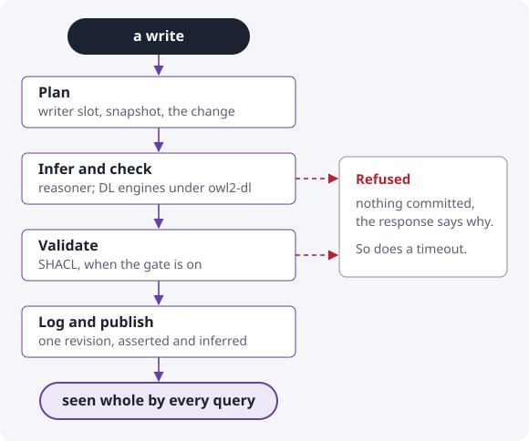

# Features and standards

What NRESE does in the commit these pages come with: first the standards it follows and their
tests, then each area with its limits beside it. What it leaves out, and where it departs from a
standard with what to do instead, is in [limits](limits.md), which starts with
[when to choose another system](limits.md#choose-another-system-when).

## Standards

Each W3C suite below runs in our checks, and the [release gate](../benches/fast/w3c-expected.toml)
requires the counts shown to pass, with no failure. A test we know we fail is listed, with its
reason, beside its runner.

| Standard | What NRESE does | Tests |
|---|---|---|
| [SPARQL 1.1](https://www.w3.org/TR/sparql11-overview/) [Query](https://www.w3.org/TR/sparql11-query/), [Update](https://www.w3.org/TR/sparql11-update/), [Federated Query](https://www.w3.org/TR/sparql11-federated-query/) | All of it but Update's `LOAD`, with the [deviations listed](limits.md#sparql) | 505 W3C tests, no known failure ([runner](../crates/nrese-sparql/tests/w3c_sparql11)) |
| [SPARQL 1.1 Protocol](https://www.w3.org/TR/sparql11-protocol/), [Graph Store Protocol](https://www.w3.org/TR/sparql11-http-rdf-update/), [Service Description](https://www.w3.org/TR/sparql11-service-description/) | Served at `/dataset/…` ([HTTP interface](ops/http-api.md)) | Our own ([protocol](../crates/nrese-server/tests/it/query_protocol_tests.rs), [Graph Store](../crates/nrese-server/tests/it/graph_store_api_tests.rs)) |
| Results as [JSON](https://www.w3.org/TR/sparql11-results-json/), [XML](https://www.w3.org/TR/rdf-sparql-XMLres/), [CSV and TSV](https://www.w3.org/TR/sparql11-results-csv-tsv/) | Written, and read but for CSV | The SPARQL suites read JSON, XML and TSV and check the CSV writer, and [round trips](../crates/rdf/nrese-sparql-results/tests/round_trip_tests.rs) check the others |
| [Turtle](https://www.w3.org/TR/turtle/), [TriG](https://www.w3.org/TR/trig/), [N-Triples](https://www.w3.org/TR/n-triples/), [N-Quads](https://www.w3.org/TR/n-quads/), [RDF/XML](https://www.w3.org/TR/rdf-syntax-grammar/) | Read and written, RDF 1.1 and the RDF 1.2 drafts | RDF 1.1 and 1.2 syntax suites, [runner](../crates/rdf/nrese-rdf-io/tests/w3c_rdf) |
| [JSON-LD 1.1](https://www.w3.org/TR/json-ld11/) | Read and written, remote contexts not fetched | `toRdf`, `expand`, `fromRdf`, [runner](../crates/rdf/nrese-rdf-io/tests/w3c_jsonld) |
| [RDF Dataset Canonicalization](https://www.w3.org/TR/rdf-canon/) | RDFC-1.0 | [runner](../crates/rdf/nrese-rdf-io/tests/w3c_rdfc) |
| [SPARQL 1.2](https://www.w3.org/TR/sparql12-query/) and [RDF 1.2](https://www.w3.org/TR/rdf12-concepts/) drafts | Triple terms and directional strings | 269 W3C tests, no known failure |
| [RDF Schema 1.1](https://www.w3.org/TR/rdf11-schema/) | Its entailment rules, with the [few left out](spec/reasoning-semantics.md#modes) listed | No W3C suite run |
| [OWL 2 RL](https://www.w3.org/TR/owl2-profiles/#OWL_2_RL) | The OWL 2 RL/RDF rules, materialised and maintained with each write | 86 W3C test cases, 7 of them passed only under `owl2-dl`, and 3 skipped whose premise is in no RDF syntax or imports another ontology ([runner](../crates/nrese-store/tests/w3c_owl2_rl)) |
| [OWL 2 QL](https://www.w3.org/TR/owl2-profiles/#OWL_2_QL) | Rules plus query rewriting | W3C test cases, [9 known failures](../crates/nrese-store/tests/w3c_owl2_ql/expected-failures.txt) |
| [OWL 2 DL](https://www.w3.org/TR/owl2-direct-semantics/) | Consistency, classification, realisation, proven answers | 410 W3C test cases answered as expected, and [1 whose expected answer is wrong](../crates/nrese-dl/tests/tableau_w3c/disputed.txt), shown by a model ([runner](../crates/nrese-dl/tests/tableau_w3c)) |
| [SHACL](https://www.w3.org/TR/shacl/) Core and SHACL-SPARQL | On request, or as a gate on writes | 98 Core and 22 SHACL-SPARQL W3C tests, no known failure ([runner](../crates/nrese-shacl/tests/w3c_shacl)) |
| [GeoSPARQL 1.1](https://docs.ogc.org/is/22-047r1/22-047r1.html) | In part: functions and relations over WKT, GeoJSON and simple GML | 194 of the 212 compliance tests, 18 disputed with the reference ([runner](../crates/nrese-sparql/tests/geosparql_compliance)) |
| [RDF4J REST protocol](https://rdf4j.org/documentation/reference/rest-api/) | Served at `/repositories/…`, so RDF4J clients and tools connect | Our own ([protocol](../crates/nrese-server/tests/it/rdf4j_protocol_tests.rs), [clients](../crates/nrese-server/tests/it/client_compat_tests.rs)) |

## SPARQL

| Capability | Limits and notes |
|---|---|
| [SPARQL 1.1](https://www.w3.org/TR/sparql11-overview/) [Query](https://www.w3.org/TR/sparql11-query/), [Update](https://www.w3.org/TR/sparql11-update/) and [Federated Query](https://www.w3.org/TR/sparql11-federated-query/) | Every W3C test also runs on a second evaluator written plainly from the specification's algebra ([`nrese-sparql-reference`](../crates/nrese-sparql-reference)). Deviations, each with what to do: [limits](limits.md#sparql) |
| [SPARQL 1.2](https://www.w3.org/TR/sparql12-query/) and [RDF 1.2](https://www.w3.org/TR/rdf12-concepts/) drafts: triple terms, directional strings | Results announce `version 1.2` when they may use them ([HTTP interface](ops/http-api.md#sparql)) |
| [SPARQL 1.1 Protocol](https://www.w3.org/TR/sparql11-protocol/), [Graph Store Protocol](https://www.w3.org/TR/sparql11-http-rdf-update/), [Service Description](https://www.w3.org/TR/sparql11-service-description/) | [HTTP interface](ops/http-api.md) |
| Results in [JSON](https://www.w3.org/TR/sparql11-results-json/), [XML](https://www.w3.org/TR/rdf-sparql-XMLres/), [CSV and TSV](https://www.w3.org/TR/sparql11-results-csv-tsv/), and graphs in seven RDF syntaxes ([which](ops/http-api.md#requests-in-detail)) | Chosen by `Accept` ([formats](ops/http-api.md#sparql)). The library reads results back in every format but CSV |
| `EXPLAIN`: the plan with estimated rows, or the run with actual rows and times | A reader of only some graphs gets no plan steps (they would reveal statistics of the others) |
| Full-text search (BM25) through the `bds:` and Jena `text:query` vocabularies, with phrases, prefixes, fuzzy words and stemming in 18 languages | One index over every string literal, built at the first search; an on-disk store keeps it across restarts ([full-text](ops/http-api.md#sparql)) |
| Vector search: vectors as literals (`"[…]"^^nrv:vector`), `SERVICE nrv:search` with cosine, dot product or Euclidean distance, exact or through HNSW, filtered by the rest of the query | You bring the vectors; the store computes no embeddings. Approximate search trades recall for speed through `nrv:searchBudget` ([vector search](ops/http-api.md#sparql)) |
| [GeoSPARQL 1.1](https://docs.ogc.org/is/22-047r1/22-047r1.html), in part: functions and relations over WKT, GeoJSON and simple GML, with an R-tree | Measures in metres only in CRS84 and a listed set of projected systems; no GML arcs or 3D solids ([GeoSPARQL](ops/http-api.md#sparql)) |

## RDF syntaxes

| Capability | Limits and notes |
|---|---|
| Read and write [N-Triples](https://www.w3.org/TR/n-triples/), [N-Quads](https://www.w3.org/TR/n-quads/), [Turtle](https://www.w3.org/TR/turtle/), [TriG](https://www.w3.org/TR/trig/), [RDF/XML](https://www.w3.org/TR/rdf-syntax-grammar/) | In the W3C suites, each document is also read one byte at a time and written back |
| Read and write [JSON-LD 1.1](https://www.w3.org/TR/json-ld11/) | Remote contexts aren't fetched: a library caller supplies a document loader. The W3C tests for JSON-LD 1.0 processors only, and for generalised RDF, are not run |
| Read [Notation3](https://w3c.github.io/N3/spec/) data, in the library | Only what RDF can hold; rules are read by the reasoner. Not offered over HTTP. W3C N3 group's parser tests, one known failure listed ([runner](../crates/rdf/nrese-rdf-io/tests/w3c_n3)) |
| RDF4J Binary RDF, versions 1 and 2 | Read in both versions, written as version 2; as a payload and a result format |
| [RDF Dataset Canonicalization](https://www.w3.org/TR/rdf-canon/) (RDFC-1.0) | |
| Bulk loading, N-Triples and N-Quads read on all cores; statements that don't parse are quarantined, not fatal ([loading data](ops/server-setup.md#loading-data)) | Malformed XML or JSON and read errors still stop the load, and strict mode stops at the first bad statement ([quarantine](design/quarantine.md)) |

## Reasoning

Inferences are materialised. They are computed when data is loaded, kept up to date by every
write in the same revision (by a bulk load or an import, in the next one), and stored apart from
the asserted statements. A query reads both
by default, or only the asserted ones with `infer=false`.

Reasoning is chosen per repository with [`reasoner.mode`](ops/config-reference.md#reasoner.mode). What each mode computes, what it leaves
out and what its answers promise is in [the reasoning contract](spec/reasoning-semantics.md#modes), and
the W3C tests of each profile are under [standards](#standards).

| Mode | Follows |
|---|---|
| `disabled` (the default) | No reasoning |
| `rdfs` | The [RDFS entailment rules](https://www.w3.org/TR/rdf11-mt/#patterns-of-rdfs-entailment-informative) rdfs2, rdfs3, rdfs5, rdfs7, rdfs9 and rdfs11: domain, range, sub-class and sub-property |
| `rdfs-full` | The RDFS entailment rules and axioms of [RDF 1.1 Semantics](https://www.w3.org/TR/rdf11-mt/), but the few the contract lists |
| `rdfs-plus`, `owl-horst` | RDFS plus equality and inverse, symmetric, transitive and functional properties, and for `owl-horst` also `hasValue`, `someValuesFrom` and `allValuesFrom` |
| `owl2-ql` | The [OWL 2 QL](https://www.w3.org/TR/owl2-profiles/#OWL_2_QL) rules, and answers through existential axioms by query rewriting ([design](design/ql-rewriting.md)). A query with a dataset of its own doesn't get the rewriting, so its answers say `sound-only` |
| `owl2-rl` | The [OWL 2 RL/RDF rules](https://www.w3.org/TR/owl2-profiles/#Reasoning_in_OWL_2_RL_and_RDF_Graphs_using_Rules) |
| `owl2-dl` | The OWL 2 RL rules as a lower bound, and the [OWL 2 Direct Semantics](https://www.w3.org/TR/owl2-direct-semantics/) through engines of its own, a hypertableau and a consequence-based core, for consistency, classification, realisation and the certain answers they can prove ([design](design/owl2-dl.md)) |
| `custom` | Your rules alone, in [Notation3](https://w3c.github.io/N3/spec/) or the `.pie` rule format. Such rules can be added to every mode above as well |

A commit that, with its inferences, breaks a consistency rule of the mode is refused, and the
response names the rule and its premises ([consistency](spec/reasoning-semantics.md#consistency)).

Beside the modes:

- With reasoning on, you can ask why a statement holds and get its derivation, or the minimal
  sets of asserted statements it follows from, and under `owl2-dl` the minimal sets of axioms (`/explain`,
  [HTTP interface](ops/http-api.md#engine-api-apiv1)).
- `nrese-server print-query` writes a query out as plain SPARQL 1.1 that, on a store without
  reasoning holding the same statements, answers as NRESE does under `owl2-rl` with the QL
  rewriting, and says when a query can't be written so ([commands](ops/server-setup.md#commands)).
- The DL engines classify and realise the ontology in any mode
  ([HTTP interface](ops/http-api.md#classification)).
- The inferences are maintained incrementally, and this is tested against full recomputation on
  random changes ([maintenance](spec/reasoning-semantics.md#maintenance)).
- Stored inferences carry a fingerprint of the rules that made them, so after an upgrade a build
  that changes what a ruleset derives recomputes them once at start
  ([freshness](spec/reasoning-semantics.md#freshness)).
- Rules read every graph, and inferences go to the default graph, so a named graph isn't a
  reasoning boundary yet ([graph scope](spec/reasoning-semantics.md#graph-scope)).

### What an answer promises

Every SPARQL query answer carries its status in an `NRESE-Completeness` header, whatever the
query form and the protocol. `EXPLAIN` shows the same status, and classification and realisation
carry it too ([details](ops/http-api.md#sparql)). Graph and statement downloads (Graph Store,
RDF4J `/statements`) carry none.

What each status promises under each mode is in
[the reasoning contract](spec/reasoning-semantics.md#what-complete-refers-to), and the header's
form, with its regime and reasons, in the [HTTP interface](ops/http-api.md#sparql). Inside a
transaction whose pending changes delete statements, answers are `unsound`, because those
statements' inferences stay until the commit.

Under `owl2-dl` you can ask for exact answers only (`dl-answers=exact`), and an answer that
can't be proven complete is then a 422 error naming the undecided candidates.

## SHACL

| Capability | Limits and notes |
|---|---|
| [SHACL](https://www.w3.org/TR/shacl/) (W3C Recommendation, 2017): Core and SHACL-SPARQL | Data is validated with its inferred statements unless `infer=false`. Not supported: SHACL Advanced Features (rules), and `sh:entailment`, which is reported as a failure |
| Validation on request (`/dataset/shacl`), against stored shapes or shapes sent with the request | Sent shapes live in a transaction that is never committed, and count against the request's memory ([HTTP interface](ops/http-api.md#shacl-validation)) |
| Validation on commit (`shacl.gate`: `report` or `enforce`), only for the focus nodes the commit can affect | Off by default. `enforce` refuses results of [`shacl.gate_severity`](ops/config-reference.md#shacl.gate_severity) or above, `violation` by default |

## Storage, transactions and durability

| Capability | Limits and notes |
|---|---|
| Its own storage engine: dictionary-encoded terms, sorted index orders (seven; four while all data is in the default graph), log-structured runs, snapshots that readers never wait for ([architecture](ARCHITECTURE.md#4-engine-design-l1)) | |
| In memory or on disk: a checksummed write-ahead log and checkpoints; recovery cuts a torn tail and, unless configured otherwise, refuses to open on other damage | |
| Atomic commits: a write is planned, validated (reasoning, consistency, SHACL) and committed as one revision; a request that times out commits nothing ([data flow](ARCHITECTURE.md#22-data-flow)) | One writer at a time |
| Client transactions, over the RDF4J protocol or the engine API: reads see the transaction's own changes | Each read takes the latest commit; `SNAPSHOT` and `SERIALIZABLE` isolation are refused |
| Backups: N-Quads exports with a checksum, image backups, point-in-time restore from the archived log ([backups](ops/backups.md)) | |
| Read replicas that follow a primary's log ([replication](ops/replication.md)) | No automatic failover; no partitioning across machines |
| Several repositories per server, each with its own reasoning and rules | |

### What a commit does

A write (a SPARQL update, a Graph Store write or the commit of a client transaction) is one
commit, and its operations apply in order, each one seeing the ones before it. Before anything
becomes visible:

<picture>
  <source media="(prefers-color-scheme: dark)" srcset="img/commit-dark.svg">
  
</picture>

The two checks:

1. With reasoning on, the reasoner updates the inferred statements from the change, in the same
   transaction, and checks consistency. Under `owl2-dl` the DL engines check it too, and a check
   they don't decide lets the commit through, with the status `unknown`.
2. With the SHACL gate on, the shapes validate the focus nodes the change can affect, inferred
   statements included. Only what the commit introduces counts, so data that was invalid before
   doesn't block it.

If a check refuses the write, or the request times out, nothing of the request is committed,
neither an asserted statement nor an inference, and the response says why. Otherwise the
asserted and the inferred changes are written to the log (synced, on disk) and published
together as one revision, so a query sees all of the commit or none of it. When you delete a
statement, its inferences go in the same commit, unless they still follow from what remains.
The gate's result isn't stored (`report` logs it), and `GET /dataset/shacl` validates the
current data on request.

Bulk loads (`nrese-server load` and the import endpoint) and the ontology file loaded at
start-up don't go through these checks. With reasoning on, `nrese-server load` recomputes the
inferences afterwards and fails when the rules' consistency checks find a violation. Under
`owl2-dl` those are the OWL 2 RL rules' checks, because the DL check doesn't run. The data
stays, and the store is quarantined. With reasoning off, nothing is checked
([storage contract](spec/02-storage-and-transactions.md#writes),
[consistency](spec/reasoning-semantics.md#consistency),
[SHACL gate](ops/config-reference.md)).

## Access control and operations

| Capability | Limits and notes |
|---|---|
| Authentication: static bearer tokens, [JWT](https://www.rfc-editor.org/rfc/rfc7519), [OAuth 2.0 token introspection](https://www.rfc-editor.org/rfc/rfc7662), as OIDC providers offer it, client certificates from trusted proxies, and local users with Argon2id passwords ([configuration](ops/config-reference.md#auth-modes)) | Off by default (`auth.mode = none`) |
| Graph-level access: roles, workspaces and personal spaces; each user's queries see only the graphs it may read, and the policy decides which inferences it sees ([access control](ops/http-api.md#graph-level-access-control), [ADR-0008](adr/0008-users-workspaces-policies.md)) | Endpoints over the whole dataset (classification, SHACL, autocomplete) are for readers of every graph |
| Deployment postures, from an open workbench to read-only and authenticated servers; timeouts, memory budgets per request, rate limits | [Configuration](ops/config-reference.md) |
| Health and readiness, Prometheus metrics, running queries listed and cancelled ([operations](ops/http-api.md#service-and-operations)) | |

## Interfaces

| Interface | What |
|---|---|
| `/dataset/…` | SPARQL Protocol and Graph Store Protocol for the default repository |
| `/repositories/…` | The [RDF4J REST protocol](https://rdf4j.org/documentation/reference/rest-api/), version 12 (`GET /protocol`), for RDF4J's `HTTPRepository` and the tools built on it ([HTTP interface](ops/http-api.md#rdf4j-protocol)) |
| `/api/v1/…` | One API for what the server does (the library-only parts, such as Notation3 data and resolving quarantined statements, have none yet), described as [OpenAPI 3.1](https://spec.openapis.org/oas/v3.1.0) at `/api/v1/openapi.json` ([HTTP interface](ops/http-api.md#engine-api-apiv1)) |
| `/console`, `/ops` | A browser console for queries, updates and graphs, and one for operators ([apps/nrese-console](../apps/nrese-console)) |
| `nrese-server` | The server, and the commands `load`, `query`, `convert`, `backup`, `restore`, `prune-archive`, `check-config`, `config-schema` and `print-query` ([commands](ops/server-setup.md#commands)) |
| Console CLI | A small TypeScript command-line client of the same API ([getting started](dev/getting-started.md#frontend-cli)) |
| Errors | Every HTTP error is a problem document ([RFC 9457](https://www.rfc-editor.org/rfc/rfc9457)) with the request id the server's log also carries, with three exceptions ([status codes](ops/http-api.md#status-codes), [a worked example](ops/http-api.md#example-a-sparql-syntax-error)); a server that doesn't start says why on standard error ([startup errors](ops/server-setup.md#startup-errors)) |

Configuration comes from a TOML file, environment variables or `--set`, with a JSON
Schema (`nrese-server config-schema`). The [Dockerfile](../Dockerfile) builds images for
`linux/amd64` and `linux/arm64`.
